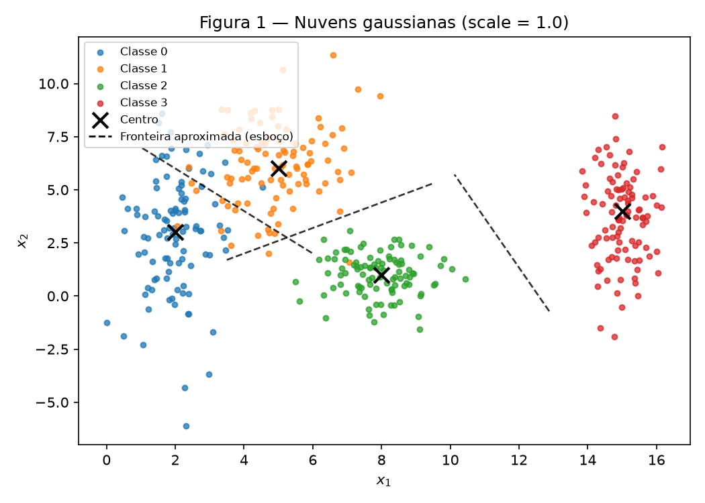
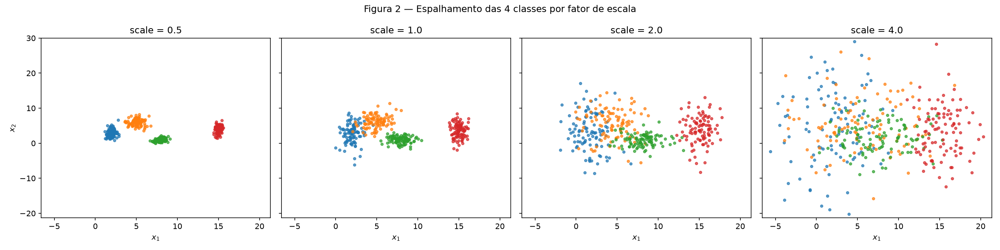
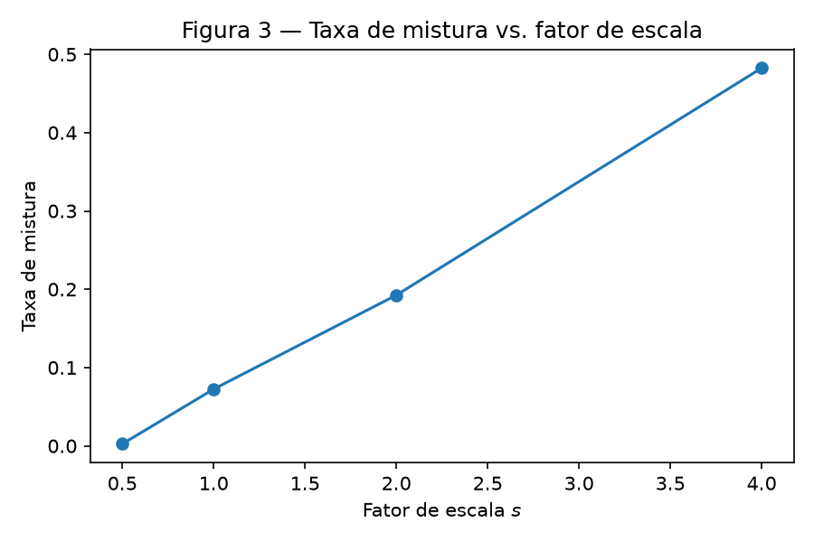
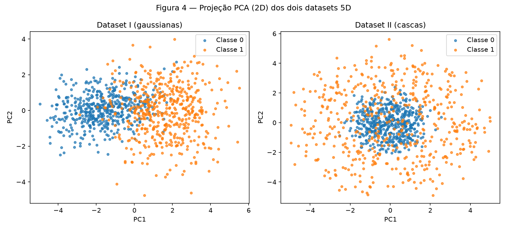
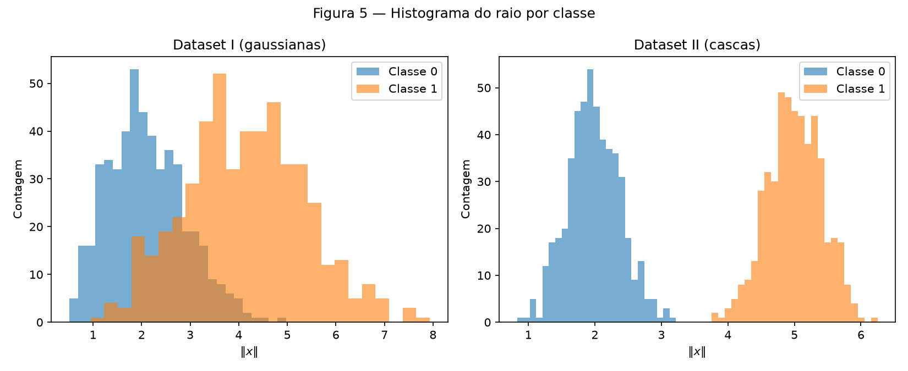
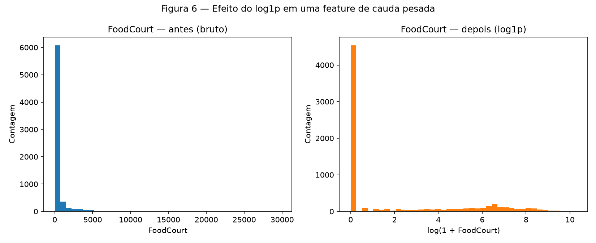

# 1. Data

!!! abstract "Enunciado"

    [Exercises → Data](https://insper.github.io/ann-dl/){:target='_blank'}

## Exercise 1

### Abordagem

Gerei as 4 classes gaussianas 2D com os parâmetros do enunciado (médias fixas, desvios-padrão
escalados por `s ∈ {0.5, 1.0, 2.0, 4.0}`) usando `rng = np.random.default_rng(42)`. A razão de
separação `r_ij` é calculada de forma analítica (a partir dos parâmetros, não de amostras) e a
taxa de mistura compara cada ponto amostrado às 4 médias verdadeiras — nenhum modelo é treinado,
como exige o enunciado.

### Código

``` { .python .copy .select linenums='1' title="docs/exercises/data/code/exercise1_point_clouds.py" }
--8<-- "docs/exercises/data/code/exercise1_point_clouds.py"
```

1.  Semente fixa: sem ela, os números da tabela de resultados mudam a cada execução e a
    correção não consegue reproduzir o seu relatório.
2.  `plt.close(fig)` evita o vazamento de figuras quando o script gera várias em sequência.

### Figuras


/// caption
**Figura 1** — Dispersão das quatro classes no plano `(x1, x2)` com `scale = 1.0`, centros
marcados com ✕ e esboço das fronteiras entre classes vizinhas (linha tracejada — item C).
///


/// caption
**Figura 2** — As mesmas 4 classes em 4 fatores de escala, eixos compartilhados.
///


/// caption
**Figura 3** — Taxa de mistura cresce com o fator de escala `s`.
///

### Análise

**B — Mais ou menos espalhado**

> Calcule a razão de separação de cada par de classes `(i, j)` em `s = 1`; reporte-os em uma
> tabela e diga qual é o menor.

| Par | `r_ij` (s = 1,0) |
|---|---|
| (0, 1) | **1,326** ← menor |
| (1, 2) | 2,380 |
| (0, 2) | 2,480 |
| (2, 3) | 3,542 |
| (1, 3) | 3,642 |
| (0, 3) | 4,496 |

> Como as médias não mudam, `r_ij` escala com `1/s`: diga quanto vale esse menor `r_ij` em
> `s = 2` sem precisar gerar nada de novo.

O menor par é (0, 1). Como `r_ij(s) = r_ij(1)/s`, em `s=2`: `1,326 / 2 = 0,663`.

> Responda: a partir de qual fator de escala as nuvens deixam de poder ser separadas por retas?
> O que acontece com o menor `r_ij` nesse ponto?

Resolvendo `r_01(s) = 1,326/s = 1`, obtemos `s ≈ 1,33`: a partir daí, a distância
entre os centros das Classes 0 e 1 passa a ser **menor** que a soma dos espalhamentos médios das
duas nuvens, ou seja, elas deixam de ter uma margem clara entre si. Isso é consistente com a
taxa de mistura medida (Figura 3): ela já é 7,25% em `s=1`, mas salta para 19,25% em `s=2` —
o crescimento mais acentuado acontece justamente na faixa em que `r_01` cruza 1.

**C — Análise**

> Descreva a sobreposição das quatro classes no dataset original (`s = 1`). Uma única fronteira
> linear separaria todas as classes? E um conjunto de fronteiras lineares?

Em `s=1`, as Classes 0 e 1 já se sobrepõem visivelmente (menor `r_ij` do conjunto, 1,326) por
causa do desvio vertical grande da Classe 0 (`sigma_y = 2,5`); as Classes 1-2 e 2-3 têm alguma
sobreposição nas bordas; a Classe 3 fica isolada à direita (`r_03 = 4,496`, o maior par). Uma
única reta não separa as 4 classes — elas não estão dispostas ao longo de uma direção comum. Um
conjunto de 3 retas (uma entre cada par de classes vizinhas, como na Figura 1) já separa a
maior parte dos pontos corretamente, mas não todos: com `s=1` a taxa de mistura já é 7,25%
mesmo usando a fronteira ótima (mais próxima do centro), porque as gaussianas se sobrepõem em
probabilidade, não apenas em posição.

> Esboce sobre a Figura 1 as fronteiras de decisão que você acha que uma rede neural treinada
> poderia aprender.

Feito na Figura 1 (linhas tracejadas): cada segmento é a bissetriz perpendicular entre os
centros de duas classes vizinhas — a fronteira que um classificador de "centro mais próximo"
(a mesma regra usada para calcular a taxa de mistura) aprenderia.

> Relacione o esboço com o item B: quanto mais espalhadas as nuvens, o que acontece com a
> região onde a rede necessariamente erra?

As fronteiras esboçadas não mudam de posição com `s` (dependem só das médias, que são fixas),
mas a nuvem de pontos ao redor delas fica mais larga conforme `s` cresce. Ou seja, a **região de
erro inevitável** — a faixa de cada lado da fronteira onde pontos de uma classe caem do lado da
outra — cresce proporcionalmente ao espalhamento. Isso é exatamente o que a Figura 3 mostra:
0,25% → 7,25% → 19,25% → 48,25% conforme `s` vai de 0,5 a 4,0.

## Exercise 2

### Abordagem

Para o Dataset I, amostrei 500 pontos por classe com `rng.multivariate_normal` usando as médias
e matrizes de covariância do enunciado (5×5, com correlações fora da diagonal). Para o Dataset
II, sorteei direções uniformes na esfera unitária de ℝ⁵ (`v ~ N(0, I)`, depois normalizado) e
multipliquei por um raio `ρ ~ N(μ, 0,4)` — `2,0` para o núcleo, `5,0` para a casca, interpretando
o segundo parâmetro do enunciado como desvio-padrão (ver ressalva na Discussão). Reduzi os dois
datasets a 2D com PCA só para visualizar; todas as métricas numéricas (distância entre centros,
raio) foram calculadas em 5D, no espaço original.

### Código

``` { .python .copy .select linenums='1' title="docs/exercises/data/code/exercise2_nonlinearity.py" }
--8<-- "docs/exercises/data/code/exercise2_nonlinearity.py"
```

### Figuras


/// caption
**Figura 4** — Dataset I (gaussianas deslocadas) e Dataset II (cascas concêntricas)
projetados em 2D via PCA.
///


/// caption
**Figura 5** — Distribuição de `||x||` por classe, calculada em 5D.
///

!!! note "Fronteiras não lineares"

    Para justificar por que as cascas concêntricas exigem fronteira não linear, ajuda
    escrever a condição de decisão. Um separador linear é

    ```
    f(x) = w^T x + b
    ```

    enquanto a estrutura das cascas depende de `||x - μ||` (distância à origem), que não é
    expressável nessa forma.

### Análise

**C — Visualize e compare**

> Reporte a variância explicada pelos dois primeiros componentes em cada caso. Em qual dos
> datasets a projeção 2D preserva melhor a informação relevante para a classificação?

| | Dataset I | Dataset II |
|---|---|---|
| Variância explicada (PC1+PC2) | 65,97% | 43,16% |
| Distância entre centros (5D) | 3,228 | 0,267 |

A projeção 2D preserva melhor a informação do Dataset I: além de reter mais variância
(65,97% contra 43,16%), a separação entre os centros (3,228) já é grande o bastante para
aparecer clara mesmo depois de descartar 3 dimensões. No Dataset II, a PCA "desperdiça"
variância em direções que não distinguem as classes, porque a estrutura relevante (o raio) não
é a direção de maior variância — é detalhado a seguir.

**D — Análise**

> No Dataset II, a distância entre os centros é próxima de zero, mas os histogramas de raio
> ficam bem separados. O que essa combinação diz sobre a possibilidade de separar as classes
> com um hiperplano?

Diz que **não é possível** separar as classes do Dataset II com um hiperplano. Um hiperplano
`w^T x + b = 0` divide o espaço em dois lados a partir da *posição média* dos
pontos ao longo da direção `w` — e como os centros das duas classes praticamente
coincidem (distância `0,267`, contra `3,228` no Dataset I), não existe direção `w` ao
longo da qual as médias das duas classes se separem. A informação que distingue as classes está
na distância à origem, uma quantidade que qualquer projeção linear apaga.

> Explique por que a estrutura do Dataset II não pode ser resolvida por uma fronteira linear,
> por mais dados que se colete.

Por construção, o núcleo (raio `≈ 2,0`) e a casca (raio `≈ 5,0`) são duas cascas
esféricas concêntricas em torno da origem. A fronteira real que as separa é a esfera
`||x|| = c` (para algum `c` entre 2 e 5) — uma condição **quadrática** nas
coordenadas (`sum_i x_i^2 = c^2`), não linear. Coletar mais dados reduz o ruído de amostragem,
mas não muda a geometria: qualquer hiperplano vai cortar as duas cascas ao meio, errando
metade dos pontos de cada lado, não importa quantas amostras existam.

> A PCA é uma transformação linear. Discuta: uma projeção 2D em que as classes parecem
> misturadas prova que elas são inseparáveis no espaço original? Justifique com os seus
> próprios resultados e escreva uma função simples das entradas que separe o Dataset II.

Não prova. A Figura 4 mostra as classes do Dataset II bastante misturadas na projeção PCA — mas
isso é uma limitação da **projeção**, não do dado: a PCA escolhe as direções de maior variância,
que aqui não coincidem com a direção discriminativa (o raio). A prova está na Figura 5: no
espaço original (5D), o histograma de `||x||` separa as duas classes quase
perfeitamente, algo que a PCA, sendo linear, não consegue enxergar. Uma função simples que
separa o Dataset II é

```
g(x) = sum_{i=1}^{5} x_i^2 = ||x||^2
```

classificando como núcleo se `g(x) < 14,5` (ponto médio entre `2^2 = 4` e `5^2 = 25`) e
como casca caso contrário.

## Exercise 3

### Abordagem

Carreguei o `train.csv` do Spaceship Titanic, descrevi balanceamento do alvo, tipos de feature
e valores faltantes; separei treino/teste 80/20 estratificado **antes** de qualquer estatística;
imputei (mediana para numéricas, moda para categóricas) ajustando só no treino; criei
`TotalSpend`; apliquei `log1p` nas colunas de gasto (cauda pesada); codifiquei as categóricas
com one-hot (`handle_unknown="ignore"` cobre categoria nova no teste); e escalonei para
`[-1, 1]` com `MinMaxScaler` ajustado no treino, compatível com a saída de `tanh`.

### Código

O dataset (`train.csv`, baixado do Kaggle) não vai para o repositório — fica em
`code/data/train.csv`, coberto pelo `.gitignore`, por ser dado de terceiros.

``` { .python .copy .select linenums='1' title="docs/exercises/data/code/exercise3_preprocessing.py" }
--8<-- "docs/exercises/data/code/exercise3_preprocessing.py"
```

### Figuras


/// caption
**Figura 6** — `FoodCourt` bruto (esquerda, cauda longa concentrada perto de 0) e após
`log1p` (direita, distribuição bem mais próxima de uma forma simétrica).
///

### Análise

**A — Conheça os dados**

> Descreva o objetivo do dataset: o que a coluna `Transported` representa? Qual é o
> balanceamento entre as duas classes?

`Transported` indica se o passageiro foi transportado para outra dimensão durante o incidente
da nave (o alvo binário da competição). O balanceamento é quase perfeito: **50,36%** da classe
positiva no dataset completo — não há necessidade de tratar desbalanceamento de classes aqui.

> Liste as features separando numéricas de categóricas.

- **Numéricas:** `Age`, `RoomService`, `FoodCourt`, `ShoppingMall`, `Spa`, `VRDeck`.
- **Categóricas:** `HomePlanet`, `CryoSleep`, `Destination`, `VIP`.
- **Descartadas** (id/texto livre, não usadas como feature): `PassengerId`, `Name`, `Cabin`.

> Monte uma tabela de valores faltantes por coluna, em contagem absoluta e em percentual.

| Coluna | Faltantes | % |
|---|---|---|
| CryoSleep | 217 | 2,50% |
| ShoppingMall | 208 | 2,39% |
| VIP | 203 | 2,34% |
| HomePlanet | 201 | 2,31% |
| Name | 200 | 2,30% |
| Cabin | 199 | 2,29% |
| VRDeck | 188 | 2,16% |
| FoodCourt | 183 | 2,11% |
| Spa | 183 | 2,11% |
| Destination | 182 | 2,09% |
| RoomService | 181 | 2,08% |
| Age | 179 | 2,06% |

> Para as colunas de gasto, reporte média, mediana e máximo. Compare média e mediana: o que
> essa diferença indica sobre o espalhamento e a assimetria dessas distribuições?

| Coluna | Média | Mediana | Máximo |
|---|---|---|---|
| RoomService | 224,69 | 0,0 | 14.327 |
| FoodCourt | 458,08 | 0,0 | 29.813 |
| ShoppingMall | 173,73 | 0,0 | 23.492 |
| Spa | 311,14 | 0,0 | 22.408 |
| VRDeck | 304,85 | 0,0 | 24.133 |

A mediana é **zero** em todas as colunas de gasto (mais da metade dos passageiros não gastou
nada — provavelmente porque estavam em `CryoSleep`), enquanto a média fica bem acima de zero e
o máximo chega a dezenas de milhares. Essa distância enorme entre média e mediana é a assinatura
de uma distribuição de **cauda longa e fortemente assimétrica à direita**: poucos passageiros
gastam muito e puxam a média para cima, mas a maioria gasta pouco ou nada.

**B — Separe antes de transformar**

> Explique, em duas ou três frases, por que essa separação vem antes da imputação e do
> escalonamento.

Se a mediana, a moda ou os limites do escalonamento forem calculados no dataset inteiro, o
conjunto de teste "vaza" informação para o pré-processamento do treino — o modelo veria,
indiretamente, estatísticas de dados que deveria tratar como desconhecidos. O resultado é que a
métrica de desempenho reportada deixaria de estimar generalização de verdade, ficando
otimista demais.

Split obtido: **6.954** amostras de treino, **1.739** de teste (80/20 estratificado,
`random_state=42`).

**C — Pré-processe**

> Dados faltantes: defina e implemente uma estratégia por tipo de coluna e justifique cada
> escolha.

Mediana para numéricas (robusta à cauda longa das colunas de gasto — a média seria puxada pelos
outliers) e moda (`most_frequent`) para categóricas, ambas ajustadas só no treino.

> Features categóricas: explique como o seu código trata uma categoria que aparece no teste
> mas não no treino.

`OneHotEncoder(handle_unknown="ignore")`: se o teste tiver uma categoria que o encoder nunca viu
no treino, a linha recebe zero em todas as colunas daquela feature, em vez de o código quebrar.

> Cauda pesada: aplique `log(1+x)` e mostre o histograma antes e depois. Por que essa
> transformação ajuda uma rede com tanh?

Ver Figura 6. `tanh` satura (derivada perto de zero) para entradas com módulo grande — colunas
de gasto brutas, com valores até ~30.000, empurrariam a maior parte dos neurônios para a região
saturada, dificultando o aprendizado. O `log1p` comprime a cauda longa para uma escala muito
menor e mais simétrica antes do escalonamento final.

> Escalonamento: implemente uma das duas opções, explique a escolha e reporte os valores
> mínimo e máximo resultantes.

Escolhi `MinMaxScaler` para `[-1, 1]` (em vez de padronização com média 0 e desvio 1) porque o
intervalo de saída bate exatamente com a imagem de `tanh`, o que a padronização não garante.
Resultado, ajustado só no treino:

- **Treino:** mínimo `-1,0000`, máximo `1,0000` (por definição, já que o scaler foi ajustado
  nele).
- **Teste:** mínimo `-1,0000`, máximo `1,1383` — o teste ultrapassa levemente o intervalo
  porque algum valor de teste, após o `log1p`, é maior que o máximo visto no treino. Isso é
  esperado (o scaler não pode conhecer o teste) e um lembrete de que "compatível com tanh" é
  aproximado, não uma garantia absoluta fora da amostra de treino.

**D — Verifique e visualize**

> Checagens finais: não há NaN remanescente; o formato final da matriz de features (shape); o
> intervalo de valores está compatível com tanh.

- NaN remanescentes: **0** no treino e **0** no teste.
- Shape da matriz de treino: **(6954, 17)**; shape da matriz de teste: **(1739, 17)** — 7
  colunas numéricas (`Age` + 5 gastos + `TotalSpend`) mais 10 colunas one-hot
  (`HomePlanet`×3, `CryoSleep`×2, `Destination`×3, `VIP`×2).
- Intervalo: treino em `[-1, 1]` por construção; teste em `[-1, 1138]`×10⁻³ acima de 1 (ver
  item C) — compatível na prática, com a ressalva acima.

> Em um parágrafo: quais das suas decisões de pré-processamento você considera que mais
> afetariam o treinamento da rede e por quê?

A escolha do `log1p` nas colunas de gasto é provavelmente a que mais afeta o treinamento: sem
ela, a maioria dos neurônios da primeira camada oculta operaria na região saturada de `tanh`
para qualquer passageiro que tenha gastado mais que um valor moderado, matando o gradiente logo
no início do treinamento. A escolha de imputar com mediana/moda tem efeito menor porque as taxas
de faltantes são baixas (~2% por coluna).

## Results summary

Preencha **todas** as linhas — linha em branco é lida como exercício incompleto.

| # | Item | Seu valor |
|---|------|-----------|
| 1 | Taxa de mistura em `s = 0.5` | 0,25% |
| 2 | Taxa de mistura em `s = 1.0` | 7,25% |
| 3 | Taxa de mistura em `s = 2.0` | 19,25% |
| 4 | Taxa de mistura em `s = 4.0` | 48,25% |
| 5 | Menor `r_ij` em `s = 1.0` e qual é o par | 1,326 (par Classe 0 – Classe 1) |
| 6 | Distância entre os centros — Dataset I | 3,228 |
| 7 | Distância entre os centros — Dataset II | 0,267 |
| 8 | Variância explicada PC1+PC2 — Dataset I | 65,97% |
| 9 | Variância explicada PC1+PC2 — Dataset II | 43,16% |
| 10 | Proporção da classe positiva em `Transported` | 50,36% |
| 11 | Média e mediana de `FoodCourt` no treino, antes de transformar | média 458,08 / mediana 0,0 |
| 12 | `shape` final da matriz de features de treino | (6954, 17) |
| 13 | Mínimo e máximo do treino e do teste após o escalonamento | treino [-1,0000, 1,0000] / teste [-1,0000, 1,1383] |

## Discussão

O item mais delicado foi decidir o desvio-padrão do raio nas cascas concêntricas do Dataset II
— o enunciado escreve `ρ ~ N(2.0, 0.4)`, que pode ser lido como média/desvio-padrão ou
média/variância; assumi desvio-padrão e documentei isso no código, mas vale conferir com o
professor ou monitor se a intenção era outra. No Exercise 3, o teste ultrapassar levemente o
intervalo `[-1, 1]` depois do escalonamento (item C/13) foi uma surpresa útil: mostra na prática
por que "ajustar só no treino" é diferente de "garantir" um intervalo, mesmo fazendo tudo certo.

## Conclusão

Os Exercises 1 e 2 mostram dois jeitos diferentes de uma rede neural "errar": no Exercise 1,
o erro cresce continuamente à medida que as nuvens se espalham e se sobrepõem (um problema de
*quantidade* de separação); no Exercise 2, o Dataset II mostra que a distância entre centros
pode enganar completamente — classes com centros coincidentes podem ser perfeitamente
separáveis se a fronteira certa não for um hiperplano (um problema de *forma* da fronteira). O
Exercise 3 conecta isso a dados reais: a cauda pesada das colunas de gasto e a necessidade de
evitar vazamento mostram que a maior parte do trabalho antes de treinar uma rede está em decidir
como representar os dados, não no modelo em si.
