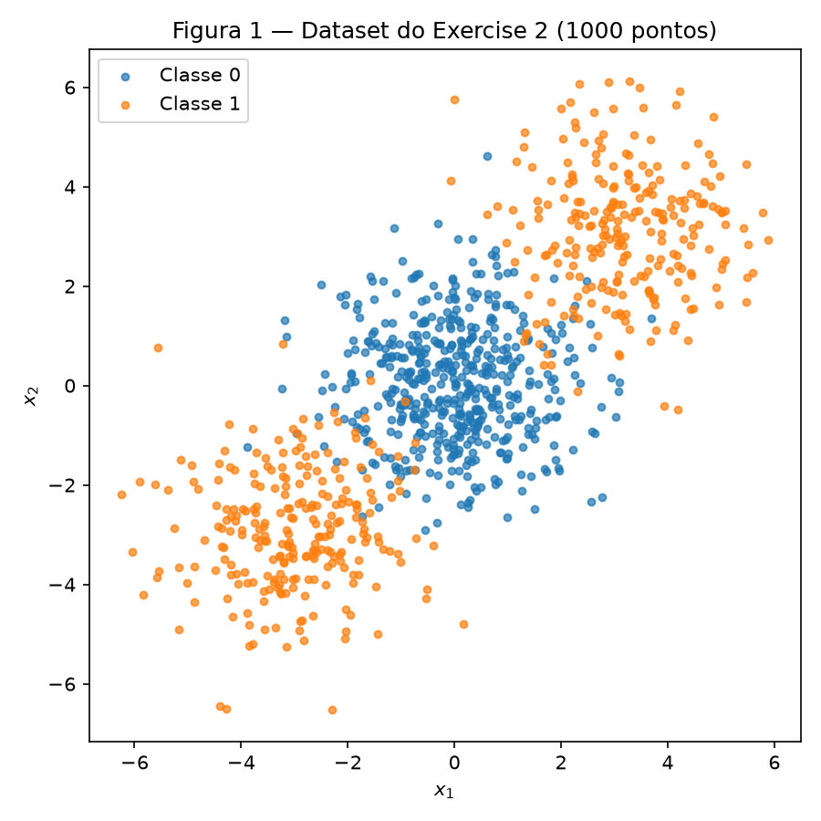
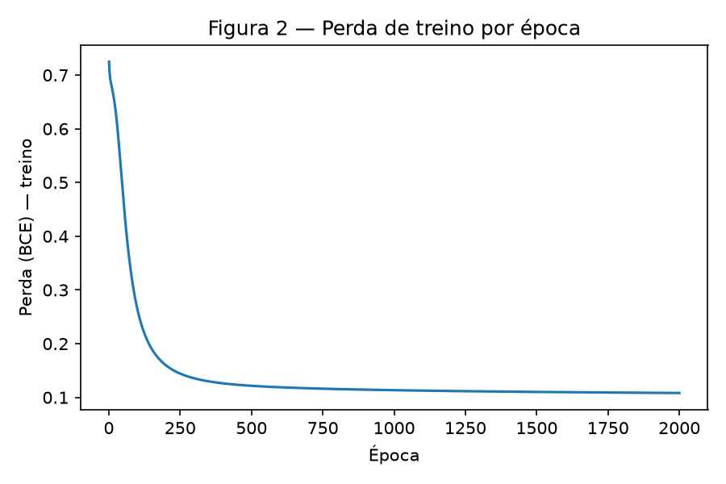
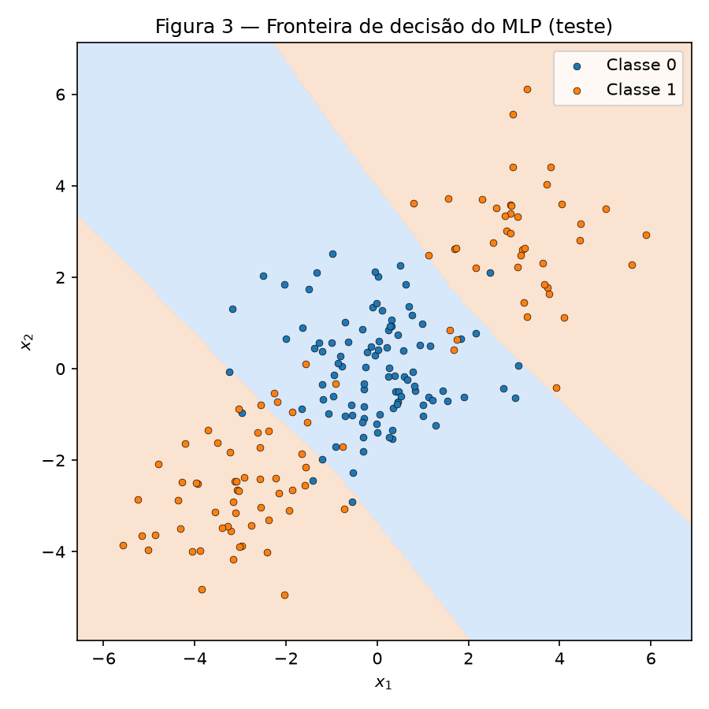
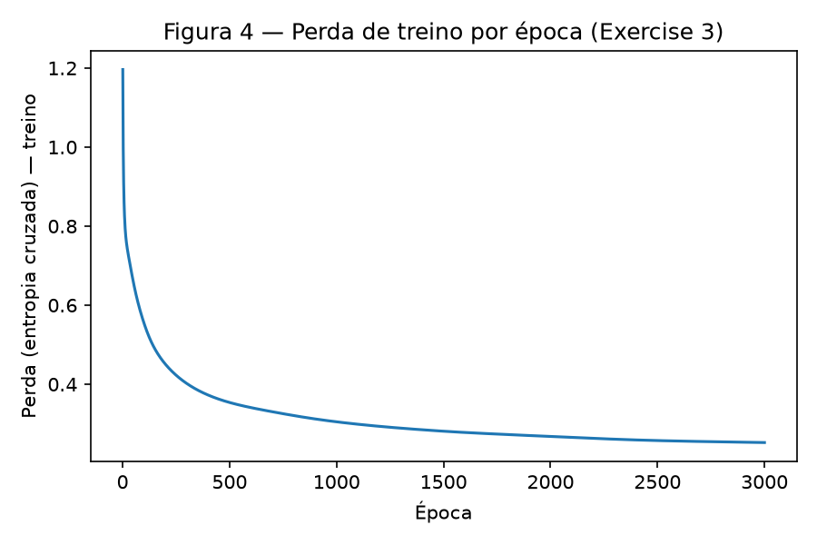
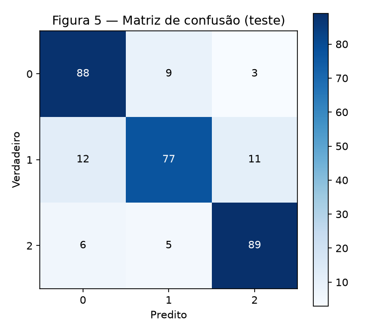
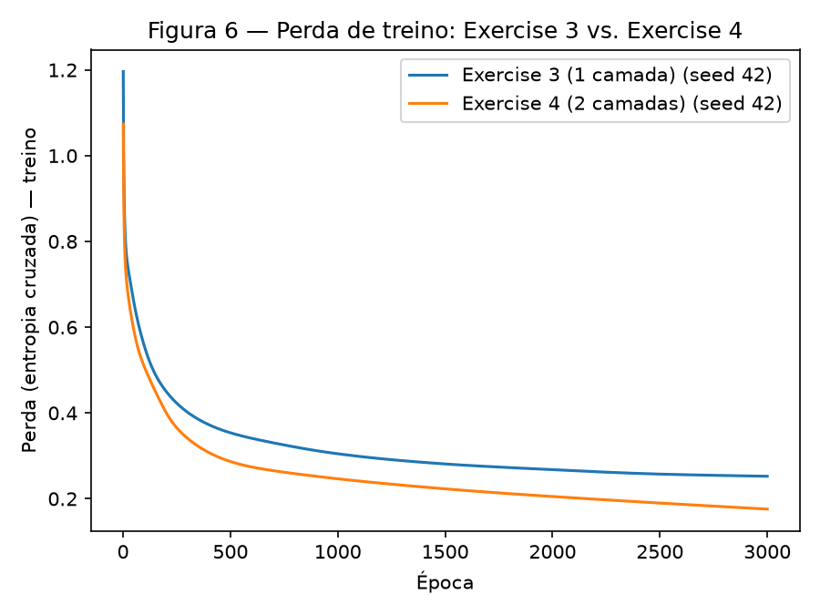

# 3. MLP

!!! abstract "Enunciado"

    [Exercises → MLP](https://insper.github.io/ann-dl/){:target='_blank'}

## Exercise 1

Rede: 2 entradas, 1 camada oculta de 2 neurônios, 1 neurônio de saída, `tanh` nas duas
camadas, perda `L = (y - yhat)^2` (MSE com `N=1`).

**Dados:** `x = [0.5, -0.2]`, `y = 1.0`,
`W1 = [[0.3, -0.1], [0.2, 0.4]]`, `b1 = [0.1, -0.2]`,
`W2 = [0.5, -0.3]`, `b2 = 0.2`, `eta = 0.3`.

### A — Passagem direta

**Pré-ativações da camada oculta** (`z1 = W1 @ x + b1`):

```
z1_0 = 0.3*0.5 + (-0.1)*(-0.2) + 0.1 = 0.1500 + 0.0200 + 0.1000 = 0.2700
z1_1 = 0.2*0.5 +   0.4*(-0.2)  - 0.2 = 0.1000 - 0.0800 - 0.2000 = -0.1800
z1 = [0.2700, -0.1800]
```

**Ativações da camada oculta** (`h1 = tanh(z1)`):

```
h1_0 = tanh(0.2700)  = 0.2636
h1_1 = tanh(-0.1800) = -0.1781
h1 = [0.2636, -0.1781]
```

**Pré-ativação e saída** (`u2 = W2 . h1 + b2`, `yhat = tanh(u2)`):

```
u2 = 0.5*0.2636 + (-0.3)*(-0.1781) + 0.2 = 0.1318 + 0.0534 + 0.2000 = 0.3852
yhat = tanh(0.3852) = 0.3672
```

**Perda:**

```
L = (y - yhat)^2 = (1.0 - 0.3672)^2 = 0.6328^2 = 0.4004
```

### B — Passagem reversa

**Saída.** Começando por `dL/dyhat` e encadeando pela derivada de `tanh`
(`d/du tanh(u) = 1 - tanh^2(u)`):

```
dL/dyhat = -2*(y - yhat) = -2*(1.0 - 0.3672) = -1.2655
dyhat/du2 = 1 - yhat^2 = 1 - 0.3672^2 = 1 - 0.1349 = 0.8651
dL/du2 = dL/dyhat * dyhat/du2 = -1.2655 * 0.8651 = -1.0948
```

**Camada de saída** (`u2 = W2 . h1 + b2`, logo `du2/dW2 = h1` e `du2/db2 = 1`):

```
dL/dW2 = dL/du2 * h1 = -1.0948 * [0.2636, -0.1781] = [-0.2886, 0.1950]
dL/db2 = dL/du2 * 1 = -1.0948
```

**Propagando de volta** (`u2 = sum_j W2_j h1_j`, logo `du2/dh1_j = W2_j`; depois a derivada
de `tanh` na camada oculta):

```
dL/dh1 = dL/du2 * W2 = -1.0948 * [0.5, -0.3] = [-0.5474, 0.3284]
dh1/dz1 = 1 - h1^2 = [1 - 0.2636^2, 1 - (-0.1781)^2] = [0.9305, 0.9683]
dL/dz1 = dL/dh1 * dh1/dz1 = [-0.5474*0.9305, 0.3284*0.9683] = [-0.5094, 0.3180]
```

**Camada oculta** (`z1 = W1 @ x + b1`, logo `dz1_i/dW1_ij = x_j` e `dz1_i/db1_i = 1`):

```
dL/dW1 = outer(dL/dz1, x) = outer([-0.5094, 0.3180], [0.5, -0.2])
       = [[-0.2547, 0.1019],
          [ 0.1590, -0.0636]]
dL/db1 = dL/dz1 = [-0.5094, 0.3180]
```

### C — Atualização dos parâmetros

Com `eta = 0.3`, `parametro <- parametro - eta * gradiente`:

| Parâmetro | Antes | Gradiente | Depois |
|---|---|---|---|
| `W2` | `[0.5000, -0.3000]` | `[-0.2886, 0.1950]` | `[0.5866, -0.3585]` |
| `b2` | `0.2000` | `-1.0948` | `0.5284` |
| `W1[0]` | `[0.3000, -0.1000]` | `[-0.2547, 0.1019]` | `[0.3764, -0.1306]` |
| `W1[1]` | `[0.2000, 0.4000]` | `[0.1590, -0.0636]` | `[0.1523, 0.4191]` |
| `b1` | `[0.1000, -0.2000]` | `[-0.5094, 0.3180]` | `[0.2528, -0.2954]` |

**A perda sobe ou desce numa segunda passagem?** Refazendo a passagem direta com os
parâmetros atualizados: `yhat_2 = 0.7112`, `L_2 = (1.0 - 0.7112)^2 = 0.0834`. A perda **desce**
de `0.4004` para `0.0834` — como esperado: um passo de gradiente descendente move os parâmetros
na direção que reduz a perda (contanto que `eta` não seja grande demais), e `yhat` se aproximou
de `y = 1.0`.

## Exercise 2

### Abordagem

Gerei os dados com `make_blobs` exatamente como especificado (3 centros, a Classe 1 dividida
em dois grupos em lados opostos da Classe 0). A linha de base é uma `LogisticRegression` do
scikit-learn (não é o modelo da entrega, só a referência). O MLP é a classe `MLP` de
`code/mlp.py`, escrita do zero (`tanh` nas camadas ocultas, sigmoide + entropia cruzada
binária na saída, gradiente descendente em lote completo) — essa mesma classe é reaproveitada
sem alterações nos Exercises 3 e 4.

### Código

O núcleo do MLP vive em [`code/mlp.py`](https://github.com/fernandoko3lle/Redes-Neurais_-_DeepLearnig/blob/main/docs/exercises/mlp/code/mlp.py):

``` { .python .copy .select linenums='1' title="docs/exercises/mlp/code/mlp.py" }
--8<-- "docs/exercises/mlp/code/mlp.py"
```

Script deste exercício: [`code/exercise2_binary.py`](https://github.com/fernandoko3lle/Redes-Neurais_-_DeepLearnig/blob/main/docs/exercises/mlp/code/exercise2_binary.py).

``` { .python .copy .select linenums='1' title="docs/exercises/mlp/code/exercise2_binary.py" }
--8<-- "docs/exercises/mlp/code/exercise2_binary.py"
```

### Figuras


/// caption
**Figura 1** — 1000 pontos: Classe 0 (1 grupo central) e Classe 1 (2 grupos opostos).
///


/// caption
**Figura 2** — Perda (BCE) de treino ao longo de 2000 épocas.
///


/// caption
**Figura 3** — Fronteira aprendida pelo MLP, avaliada em grade sobre o conjunto de teste.
///

### Análise

**C — Implemente o MLP**

Arquitetura `[2, 8, 1]` (1 camada oculta de 8 neurônios), `eta = 0.3`, 2000 épocas.
Linha de base (regressão logística): acurácia no teste = **47,50%**. MLP: acurácia no teste =
**92,00%**, perda final de treino = **0,1082**.

**D — Análise**

> Por que a linha de base linear fica abaixo de 50% enquanto o seu MLP passa de 90%? Aponte
> para a Figura 3: descreva o formato da região que sua rede atribui à Classe 1 e explique por
> que nenhuma reta sozinha consegue produzi-la.

A linha de base fica *abaixo* de 50% (não só "ruim") porque a Classe 1 está nos dois lados
opostos da Classe 0 — qualquer reta que tente separar os grupos de cima e de baixo (ambos
Classe 1) acaba cortando o grupo do meio (Classe 0) ao invés de isolá-lo, e como a Classe 0 é
maior (500 de 1000 pontos), essa reta erra sistematicamente mais do que acertaria chutando a
classe majoritária. Na Figura 3, a região que o MLP atribui à Classe 1 é uma **faixa dupla nos
dois cantos opostos** (canto inferior-esquerdo e canto superior-direito), com uma **faixa
diagonal central** reservada à Classe 0 — ou seja, a fronteira de decisão tem *duas* retas
(formando uma banda), não uma. Nenhuma reta sozinha produz isso porque uma reta só consegue
separar o plano em **dois** semiplanos; a Classe 1 precisaria estar inteiramente de um lado, mas
ela ocupa os dois lados opostos da banda central — exatamente a situação para a qual existe uma
camada oculta: cada neurônio oculto aprende uma reta diferente, e a camada de saída as combina.

## Exercise 3

### Abordagem

Gerei os dados com `make_classification` (1500 amostras, 4 features informativas, 3 classes,
2 grupos por classe) exatamente como especificado. Estendi a mesma classe `MLP` só mudando os
argumentos de instanciação — tamanho de saída 3 e `task="multiclass"` (softmax + entropia
cruzada categórica) — sem tocar no código de passagem direta, reversa ou atualização.

### Código

Script: [`code/exercise3_multiclass.py`](https://github.com/fernandoko3lle/Redes-Neurais_-_DeepLearnig/blob/main/docs/exercises/mlp/code/exercise3_multiclass.py).

``` { .python .copy .select linenums='1' title="docs/exercises/mlp/code/exercise3_multiclass.py" }
--8<-- "docs/exercises/mlp/code/exercise3_multiclass.py"
```

!!! success "Ponto extra — reutilização literal"

    `mlp.py` não foi tocado entre os Exercises 2 e 3: a classe `MLP` (passagem direta,
    reversa e atualização) é exatamente a mesma; só os argumentos de instanciação mudam
    (`layer_sizes=[4, 16, 3]`, `task="multiclass"`).

### Figuras


/// caption
**Figura 4** — Perda (entropia cruzada categórica) de treino ao longo de 3000 épocas.
///


/// caption
**Figura 5** — Matriz de confusão no conjunto de teste (300 amostras).
///

### Análise

**B — Adapte a rede**

> Derive `dL/du` para o par softmax + entropia cruzada e mostre a derivação no relatório.

Com `p = softmax(u)` e `L = -sum_k y_k log(p_k)` (`y` em one-hot), a derivada do softmax é
`dp_k/du_i = p_k * (delta_ki - p_i)` (`delta_ki = 1` se `k=i`, senão `0`). Encadeando:

```
dL/du_i = -sum_k y_k * (1/p_k) * dp_k/du_i
        = -sum_k y_k * (delta_ki - p_i)
        = -y_i + p_i * sum_k y_k
        = p_i - y_i                      (já que sum_k y_k = 1, one-hot)
```

Ou seja, `dL/du = p - y` — **a mesma forma simples** que a derivada de `dL/du` para
sigmoide + entropia cruzada binária (usada implicitamente no Exercise 2). É por isso que
`mlp.py` usa uma única linha (`delta = (y_hat - y_target) / n`) para o gradiente da camada de
saída nos dois casos — a escolha do par ativação+perda não é coincidência, é o que faz esse
gradiente ficar limpo.

**C — Treine e avalie**

Arquitetura `[4, 16, 3]`, `eta = 0,3`, 3000 épocas. Linha de base (regressão logística):
**66,33%**. MLP: **84,67%** de acurácia no teste, perda final de treino **0,2524**.

**D — Análise**

> Qual par de classes a rede mais confunde, segundo a Figura 5? [...] Reporte também a linha
> de base [...] e diga o que a camada oculta acrescentou.

O par mais confundido é **verdadeiro=Classe 1, predito=Classe 0** (12 casos, ver Figura 5) —
mais que o dobro de qualquer outro par de erro na matriz. Os dados têm 4 dimensões
informativas e 6 grupos no total (3 classes × 2 clusters cada, `class_sep=1.0`): é plausível que
um dos dois clusters da Classe 1 fique geometricamente mais próximo do cluster da Classe 0 no
espaço de 4D do que os clusters estão uns dos outros em média — com separação moderada
(`class_sep=1.0`, não muito alta), basta um cluster "vizinho" para concentrar a maioria dos
erros num único par, em vez de espalhá-los igualmente entre os 6 pares possíveis.

A camada oculta acrescentou **18,34 pontos percentuais** sobre a linha de base linear
(84,67% − 66,33%). Como os dados têm 2 clusters por classe, uma fronteira linear simples não
consegue envolver os dois clusters de uma mesma classe ao mesmo tempo sem invadir território de
outras classes — a camada oculta permite que a rede combine várias fronteiras lineares (uma
por neurônio) em regiões não convexas, cobrindo os clusters separados de cada classe.

## Exercise 4

### Abordagem

Mesmos dados, `eta` e número de épocas do Exercise 3 — a única mudança é a arquitetura:
`[4, 16, 3]` (Exercise 3, 1 camada oculta) vira `[4, 16, 16, 3]` (Exercise 4, 2 camadas ocultas
do mesmo tamanho cada, para isolar o efeito da profundidade e não o da largura). Treinei as
duas arquiteturas em 3 sementes de inicialização (`42, 43, 44`) e reportei a média.

### Código

Script: [`code/exercise4_depth.py`](https://github.com/fernandoko3lle/Redes-Neurais_-_DeepLearnig/blob/main/docs/exercises/mlp/code/exercise4_depth.py).

``` { .python .copy .select linenums='1' title="docs/exercises/mlp/code/exercise4_depth.py" }
--8<-- "docs/exercises/mlp/code/exercise4_depth.py"
```

### Figuras


/// caption
**Figura 6** — Perda de treino (seed 42): Exercise 3 (1 camada) vs. Exercise 4 (2 camadas).
///

### Análise

**A/B — Rede mais profunda e comparação**

| | Camadas ocultas | Parâmetros | Perda final de treino (média) | Acurácia no teste (média) |
|---|---|---|---|---|
| Exercise 3 | 1 (`[16]`) | 131 | 0,2637 | 85,44% |
| Exercise 4 | 2 (`[16, 16]`) | 403 | 0,1714 | 84,67% |

(médias sobre as sementes 42, 43 e 44; valores individuais por semente estão na saída de
`code/exercise4_depth.py`)

**C — Análise**

> Reporte o que você mediu. Explique o resultado — inclusive quando a profundidade perde.

Medi exatamente o padrão que o enunciado antecipa: a rede mais profunda **não** supera a mais
rasa — fica **0,78 ponto percentual pior** em média (85,44% → 84,67%), mesmo tendo uma perda de
treino bem menor (0,2637 → 0,1714, quase a metade). Isso é informativo: a rede de 2 camadas
ajusta melhor os dados de **treino** (mais parâmetros, mais capacidade), mas essa capacidade
extra não virou acurácia melhor no **teste** — ou seja, o ganho na Figura 6 é sobre dados que a
rede já viu, não uma evidência de que ela aprendeu uma fronteira melhor.

A explicação está na estrutura dos dados: são só 6 grupos (3 classes × 2 clusters) em 4
dimensões, uma fronteira que precisa combinar algumas retas em regiões não convexas — exatamente
o que **uma** camada oculta de 16 neurônios já tem capacidade de representar bem (cada neurônio
contribui uma reta; 16 retas são mais que suficientes para contornar 6 grupos). A segunda camada
adiciona 272 parâmetros a mais (403 vs. 131) sem que o problema precise dessa capacidade extra —
ela só torna a otimização mais difícil no mesmo orçamento de épocas (mais parâmetros para
mover com o mesmo número de passos de gradiente), sem comprar nenhuma estrutura nova que a rede
rasa não pudesse representar.

Profundidade extra compensaria em dados com estrutura **hierárquica/composicional** — onde a
fronteira de decisão precisa de combinações de combinações de direções (por exemplo, um
problema do tipo "XOR de XORs", ou dados de imagem onde padrões locais se combinam em padrões
maiores). Nesses casos, uma rede rasa precisaria de exponencialmente mais neurônios numa única
camada para representar o que uma rede profunda representa com poucas camadas — não é o caso
aqui, onde a estrutura é só "6 grupos relativamente simples".

## Resumo dos resultados

| # | Quantidade | Valor |
|---|---|---|
| 1 | Ex. 1 — `z1` e `h1` | `z1 = [0,2700, -0,1800]`; `h1 = [0,2636, -0,1781]` |
| 2 | Ex. 1 — `u2`, `yhat` e `L` | `u2 = 0,3852`; `yhat = 0,3672`; `L = 0,4004` |
| 3 | Ex. 1 — os oito parâmetros atualizados | `W2=[0,5866, -0,3585]`, `b2=0,5284`, `W1=[[0,3764,-0,1306],[0,1523,0,4191]]`, `b1=[0,2528,-0,2954]` |
| 4 | Ex. 2 — acurácia da linha de base linear | 47,50% |
| 5 | Ex. 2 — arquitetura e acurácia no teste | `[2, 8, 1]`, 92,00% |
| 6 | Ex. 3 — arquitetura e acurácia no teste | `[4, 16, 3]`, 84,67% |
| 7 | Ex. 3 — par de classes mais confundido | verdadeiro=1, predito=0 (12 casos) |
| 8 | Ex. 4 — arquitetura e acurácia no teste | `[4, 16, 16, 3]`, 84,67% (média de 3 sementes) |
| 9 | Ex. 4 — diferença de acurácia em relação ao Ex. 3 (média de ≥ 3 sementes) | -0,78 p.p. |
