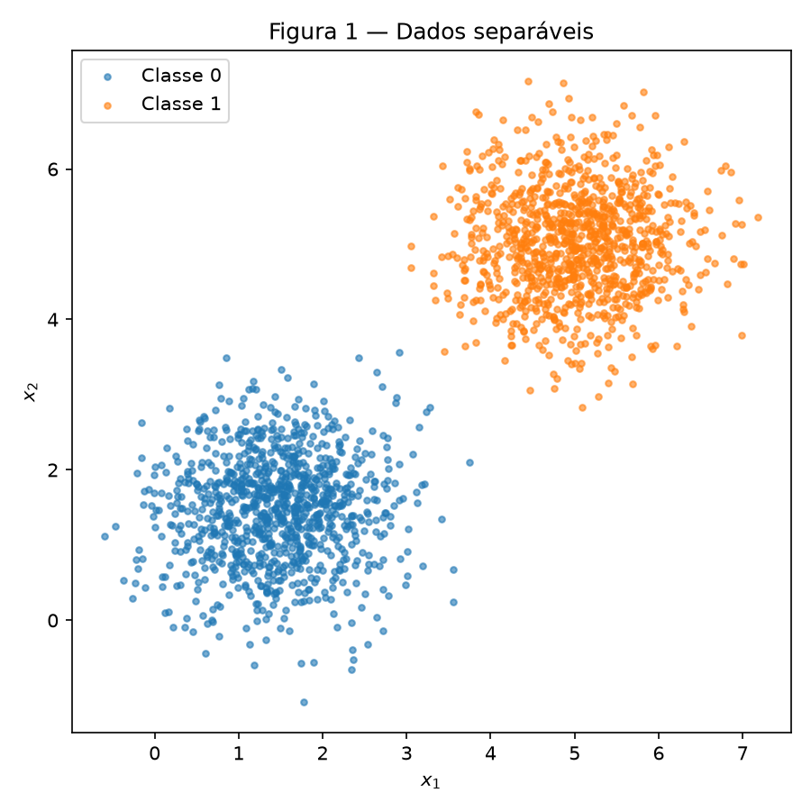
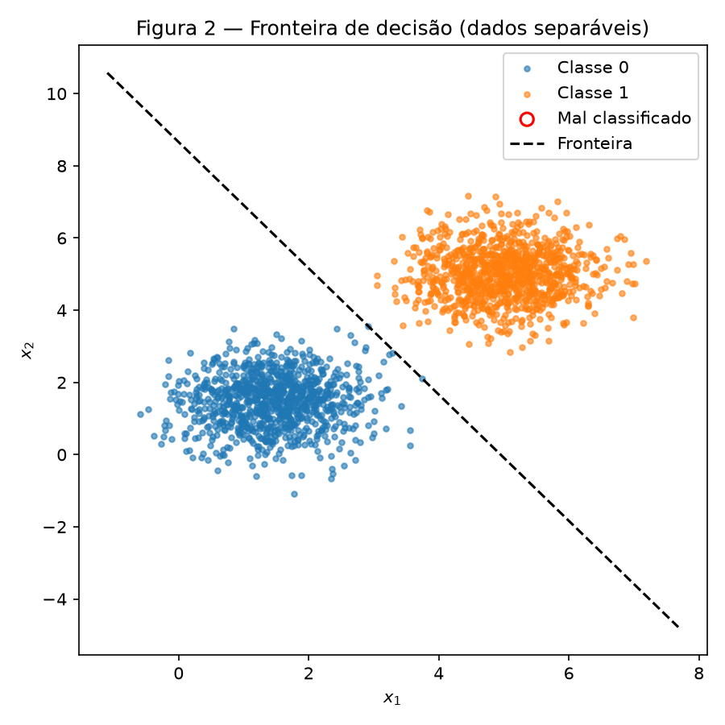
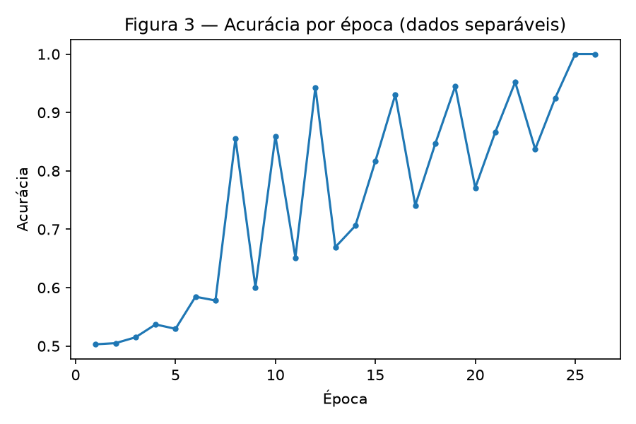
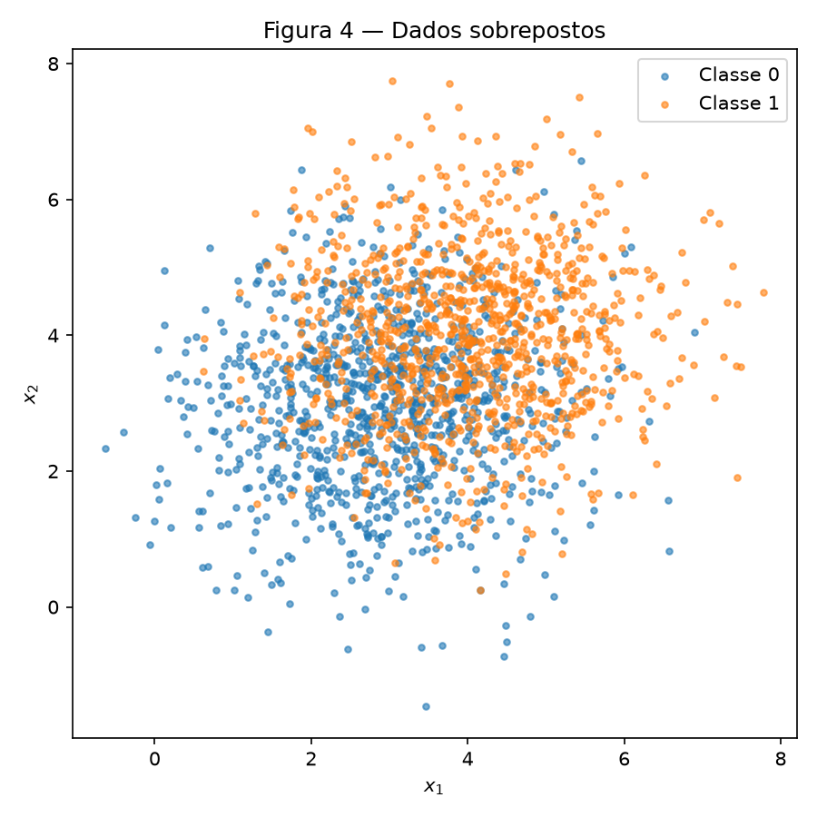
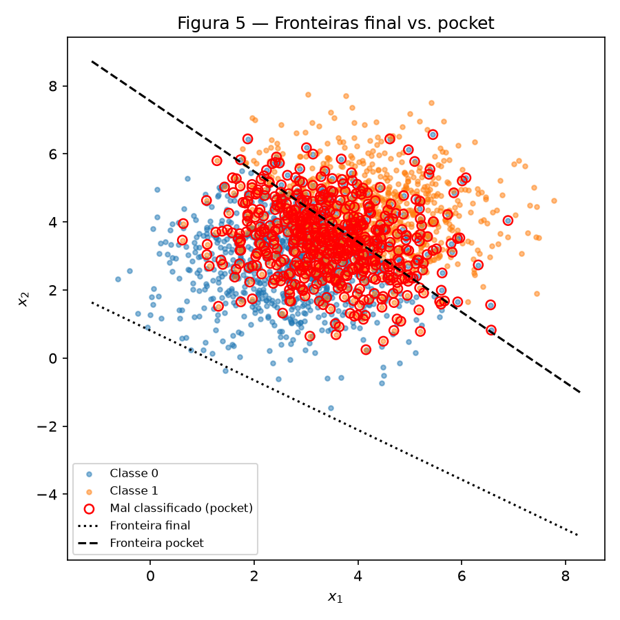
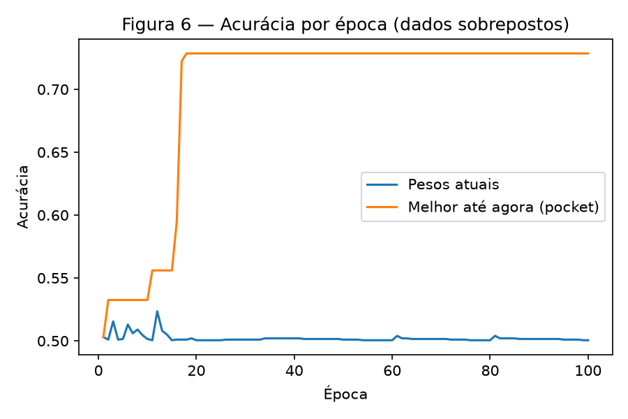

# 2. Perceptron

!!! abstract "Enunciado"

    [Exercises → Perceptron](https://insper.github.io/ann-dl/){:target='_blank'}

## Exercise 1

### Abordagem

Gerei duas classes gaussianas 2D bem separadas (médias distantes, desvio pequeno) com
`rng = np.random.default_rng(42)`. O perceptron (ativação degrau, regra
`w += eta*(y - y_hat)*x`) foi escrito do zero como uma classe simples, sem usar nenhum
modelo pronto — essa mesma classe é reaproveitada sem alterações no Exercise 2. Os pesos
iniciais saem de `rng.normal(0, 0.01, size=2)` (nunca zero) e o treino para quando uma época
inteira não gera nenhuma atualização, ou em 100 épocas.

### Código

O script vive em [`code/exercise1_separable.py`](https://github.com/fernandoko3lle/Redes-Neurais_-_DeepLearnig/blob/main/docs/exercises/perceptron/code/exercise1_separable.py).

``` { .python .copy .select linenums='1' title="docs/exercises/perceptron/code/exercise1_separable.py" }
--8<-- "docs/exercises/perceptron/code/exercise1_separable.py"
```

1.  Pesos iniciais pequenos e não nulos — o item D mostra algebricamente por que começar de
    zero anula o efeito da taxa de aprendizado.

### Figuras


/// caption
**Figura 1** — As 2000 amostras (1000 por classe), claramente separáveis.
///


/// caption
**Figura 2** — Fronteira final (`eta = 0.01`) sobre os pontos; nenhum ponto mal classificado.
///


/// caption
**Figura 3** — Acurácia sobre o dataset completo, a cada época.
///

### Análise

**C — Treine e meça**

> Treine o modelo e reporte o `w` final, o `b` final, o número de épocas e a acurácia final.

Com `eta = 0.01`: `w = [0,0505, 0,0289]`, `b = -0,2500`, convergiu em **26 épocas**, acurácia
final **100%**.

**D — Análise**

> Por que dados separáveis convergem rápido? Ligue sua resposta à regra de atualização: o que
> acontece com o número de atualizações por época ao longo do treino?

Como as duas nuvens têm uma margem grande entre si em relação ao espalhamento, a maioria dos
pontos já nasce do lado certo da fronteira inicial (quase aleatória, pesos ~0). A regra só
atualiza em cima de erro (`y - y_hat ≠ 0`), então a cada época a fronteira se aproxima mais da
região separadora e sobra cada vez menos pontos errados para corrigir. Isso aparece nos números:
as atualizações por época caem de `[3, 3, 4, 4, 3, 4, 3, 4, 2, 4, 2, 4, 2, 3, 3, 3, 2, 3, 3, 2,
3, 3, 2, 3, 1, 0]` — uma tendência de queda (com ruído, porque cada atualização desloca a
fronteira e pode "descorrigir" outro ponto) até chegar a 0 na época 26, quando o laço para.

> Re-execute o treino com `eta = 1.0`, sem mudar mais nada. Reporte a contagem de épocas e a
> acurácia final e compare a direção de `w` (ou seja, `w / ||w||`) com a da execução com
> `eta = 0.01`.

Com `eta = 1.0` (mesmos pesos iniciais que a execução com `eta = 0.01` — só o `eta` muda):
`w = [5,871, 3,359]`, `b = -31,00`, convergiu em **37 épocas**, acurácia final **100%**.

| | `eta = 0.01` | `eta = 1.0` |
|---|---|---|
| `w` final | [0,0505, 0,0289] | [5,871, 3,359] |
| `b` final | -0,2500 | -31,00 |
| Épocas | 26 | 37 |
| Direção `w/‖w‖` | [0,8681, 0,4963] | [0,8679, 0,4967] |

As duas direções são praticamente idênticas (produto escalar = `0,999999...` ≈ 1) — ou seja,
as duas execuções aprendem **a mesma fronteira geometricamente**, só que representada por
vetores de magnitude diferente. Isso mostra o que `eta` controla: o **tamanho do passo** a cada
atualização (`eta * x`, com `‖x‖` da ordem de poucas unidades aqui), não a direção para onde o
perceptron converge. Um `eta` maior dá passos maiores — por isso são necessárias contagens de
época diferentes (26 vs. 37, sem relação simples entre si, já que cada execução corrige um
conjunto de erros ligeiramente diferente ao longo do caminho) — mas ambos escalam a mesma
solução até ela classificar tudo corretamente.

> Agora argumente o que teria acontecido partindo de `w = 0`, `b = 0`. Mostre algebricamente
> que rodar todo o treino duas vezes, com `eta_1` e `eta_2`, produz pesos que diferem apenas
> pelo fator constante `eta_2 / eta_1`.

Partindo de `w = 0`, `b = 0`, a primeira predição é `degrau(0) = 1` para **toda** amostra,
qualquer que seja `eta` — o sinal da soma ponderada não depende de `eta` ainda. Logo o erro na
primeira rodada (`y - 1`, que é `0` para a Classe 1 e `-1` para a Classe 0) é o mesmo para
qualquer execução, e a primeira atualização é `w_1 = eta * (erro_1 * x_1)`, `b_1 = eta * erro_1`
— exatamente `eta` vezes o que seria a atualização de uma execução "base" com `eta_base = 1`
(chame os pesos dessa execução base de `w~`, `b~`).

Por indução: suponha que, depois de `k` atualizações, `w_k = eta * w~_k` e `b_k = eta * b~_k`
(verdadeiro para `k=1`). A predição da amostra seguinte depende só do **sinal** de
`w_k · x + b_k = eta * (w~_k · x + b~_k)`. Como `eta > 0` não muda o sinal de um número, essa
predição é idêntica à que a execução base teria — logo o erro na amostra `k+1` também é
idêntico, e a atualização `k+1` é de novo `eta` vezes a atualização base. Por indução, em
**qualquer** ponto do treino, `w = eta * w~` e `b = eta * b~`.

Isso vale para qualquer `eta > 0`: rodando o treino inteiro com `eta_1` e de novo com `eta_2`,
partindo ambos de zero, obtemos `w_{eta_1} = eta_1 * w~` e `w_{eta_2} = eta_2 * w~` — logo
`w_{eta_2} = (eta_2 / eta_1) * w_{eta_1}`, diferem só por esse fator constante. Como o sinal (e
portanto toda predição, toda contagem de erro e toda condição de parada) não muda com esse
fator, a fronteira de decisão e o número de épocas ficam **idênticos** — `eta` não teria efeito
algum. É exatamente por isso que o item B exige começar de pesos não nulos.

## Exercise 2

### Abordagem

Gerei duas classes gaussianas 2D com médias próximas e espalhamento maior (não são
linearmente separáveis) e reaproveitei a classe `Perceptron` do Exercise 1 sem nenhuma
alteração, com o mesmo `eta = 0.01` e limite de 100 épocas. Como o treino nunca vai parar de
atualizar sozinho, acrescentei — por fora da classe — o rastreio do **pocket**: a cada
atualização que melhora a acurácia no dataset completo, uma cópia de `(w, b)` é guardada.

### Código

O script vive em [`code/exercise2_pocket.py`](https://github.com/fernandoko3lle/Redes-Neurais_-_DeepLearnig/blob/main/docs/exercises/perceptron/code/exercise2_pocket.py).

``` { .python .copy .select linenums='1' title="docs/exercises/perceptron/code/exercise2_pocket.py" }
--8<-- "docs/exercises/perceptron/code/exercise2_pocket.py"
```

### Figuras


/// caption
**Figura 4** — As 2000 amostras (1000 por classe); nuvens sobrepostas, não separáveis por reta.
///


/// caption
**Figura 5** — Fronteira final (pontilhada) vs. fronteira pocket (tracejada); pontos mal
classificados pela fronteira pocket em destaque.
///


/// caption
**Figura 6** — Acurácia dos pesos atuais a cada época, contra a melhor acurácia já vista
(pocket).
///

### Análise

**B — Treine guardando os melhores pesos**

> Reporte, para os dois conjuntos: `w`, `b` e a acurácia.

| | Pesos finais | Pesos pocket |
|---|---|---|
| `w` | [0,0361, 0,0494] | [0,0068, 0,0066] |
| `b` | -0,0400 | -0,0500 |
| Acurácia | 50,05% | 72,85% |

O pocket foi atualizado pela última vez na **época 18**.

**D — Análise**

> A melhor reta para estes dados acerta cerca de 73%. Seus pesos do pocket devem chegar perto
> disso; os finais, não. Explique a diferença. Onde a fronteira final fica em relação à nuvem
> de pontos e por que o laço de treino a deixa ali?

O pocket chegou a 72,85%, bem perto do teto teórico de ~73% — é a melhor fronteira linear que
o perceptron encontrou ao longo do treino. Os pesos finais, em vez disso, ficam com acurácia de
50,05%, essencialmente equivalente a chutar: como os dados nunca ficam 100% corretos, o laço
segue atualizando para sempre, e a **última** atualização não tem motivo para ser boa — ela só
reflete o erro da última amostra malclassificada visitada antes do limite de 100 épocas, não
uma fronteira otimizada. Usando a dica do enunciado: com `‖x‖ ≈ 5` nestes dados, cada
atualização de erro move `b` por `±eta = ±0,01`, mas move `w` por `±eta·x`, cuja norma é
`≈ eta·5 = 0,05` — ou seja, `w` "anda" cerca de 5× mais que `b` por atualização. Depois de
milhares de atualizações com direções de erro que se cancelam parcialmente (já que os dois
lados da fronteira têm pontos errados), a direção de `w` fica instável e sem convergir a lugar
nenhum estável, enquanto `b` fica comparativamente "preso" perto de zero — resultado: a
fronteira final fica mal posicionada em relação à nuvem, cortando as duas classes de forma
essencialmente arbitrária.

> Compare a Figura 3 com a Figura 6. No Exercício 1 a curva de acurácia estabiliza; aqui, não.
> O que o teorema da convergência do perceptron garante e qual das suas hipóteses este dataset
> viola?

O teorema da convergência do perceptron garante que, **se as classes forem linearmente
separáveis**, o algoritmo encontra uma fronteira que classifica tudo corretamente em um número
finito de atualizações. A Figura 3 (Exercise 1) mostra exatamente essa garantia se cumprindo: a
acurácia sobe e **estabiliza** em 100%. A Figura 6 (Exercise 2) nunca estabiliza porque este
dataset **viola a hipótese de separabilidade linear** — as duas nuvens se sobrepõem, então não
existe nenhuma reta com 0% de erro, e o teorema simplesmente não se aplica: não há garantia
nenhuma de parada, e de fato ela não acontece (a curva "atual" oscila em torno de 50% do início
ao fim).

> Mais épocas resolvem? Um `eta` menor resolve? Justifique pela regra de atualização e não por
> tentativa e erro.

Não, nenhum dos dois resolve. A regra de atualização só para de mexer nos pesos quando uma
época inteira não encontra nenhum erro — e como as classes se sobrepõem, **sempre** vai existir
pelo menos um ponto do lado errado de qualquer reta, então sempre haverá pelo menos uma
atualização por época, para sempre. Mais épocas só adiam o limite, não mudam essa condição.
Um `eta` menor também não ajuda: como mostrado no Exercise 1 (item D), `eta` só reescala o
tamanho do passo — ele não muda **quais** amostras estão erradas nem cria uma fronteira que não
existia antes. O problema não é de ajuste fino de hiperparâmetro, é estrutural: o perceptron
(um classificador linear) não tem capacidade de representar uma fronteira melhor que o teto de
~73% para dados que não são linearmente separáveis.

## Results summary

Preencha **todas** as linhas — linha em branco é lida como exercício incompleto.

| # | Quantidade | Valor |
|---|------------|-------|
| 1 | Exercício 1 — `w` e `b` finais | `w = [0,0505, 0,0289]`, `b = -0,2500` |
| 2 | Exercício 1 — épocas até convergir | 26 |
| 3 | Exercício 1 — acurácia final | 100% |
| 4 | Exercício 1 — épocas e acurácia final com `eta = 1.0` | 37 épocas, 100% |
| 5 | Exercício 2 — `w` e `b` finais | `w = [0,0361, 0,0494]`, `b = -0,0400` |
| 6 | Exercício 2 — acurácia dos pesos finais | 50,05% |
| 7 | Exercício 2 — acurácia dos pesos do pocket | 72,85% |
| 8 | Exercício 2 — época em que o melhor do pocket ocorreu | 18 |

## Discussão

O ponto mais contraintuitivo foi ver a acurácia dos pesos **finais** do Exercise 2 cair para
perto de 50% em vez de estabilizar em algo próximo do pocket — reforça que, para dados não
separáveis, "deixar treinar mais" não é uma estratégia válida sem um mecanismo extra (como o
próprio pocket) para lembrar do melhor resultado já visto.

## Conclusão

Os dois exercícios mostram o perceptron nos dois lados do teorema de convergência: com
dados separáveis (Exercise 1), a regra de atualização converge rápido e de forma estável,
e a taxa de aprendizado só afeta a escala dos pesos, não a fronteira aprendida. Com dados
sobrepostos (Exercise 2), a mesma regra nunca para de atualizar, e os pesos "finais" perdem
qualquer relação com uma boa fronteira — o algoritmo pocket existe precisamente para recuperar,
de um treino que nunca converge, o melhor resultado que ele já visitou.
