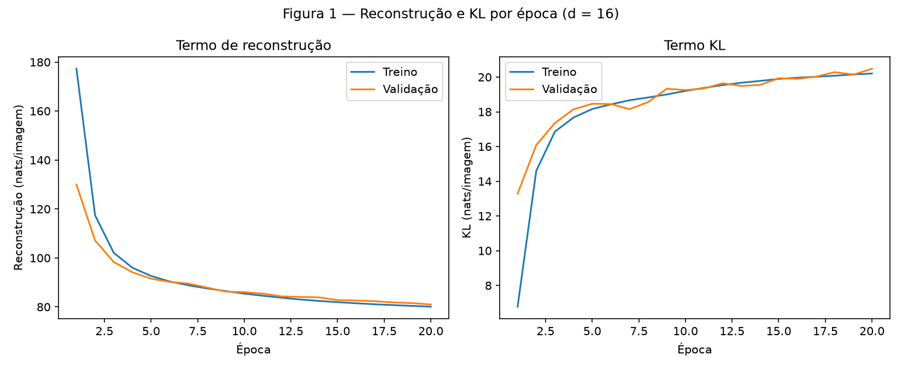
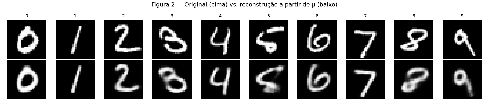
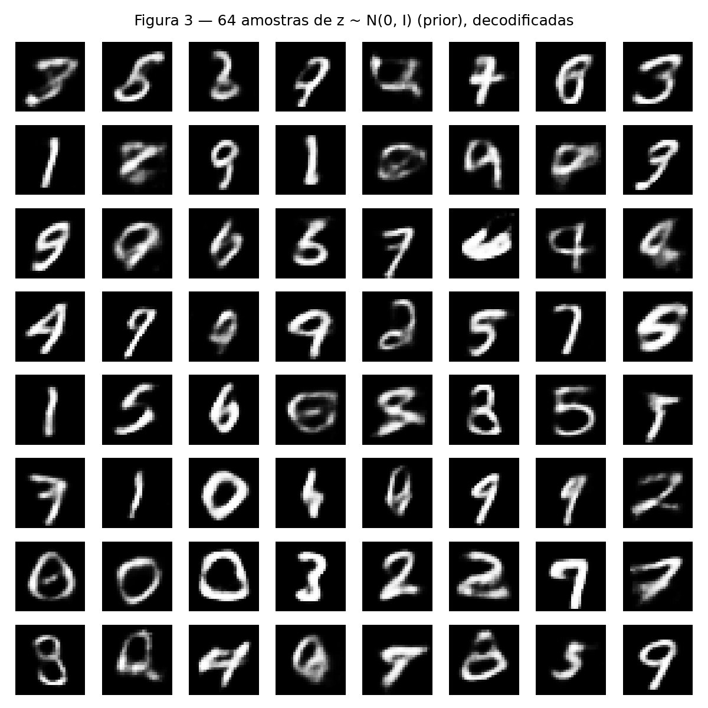
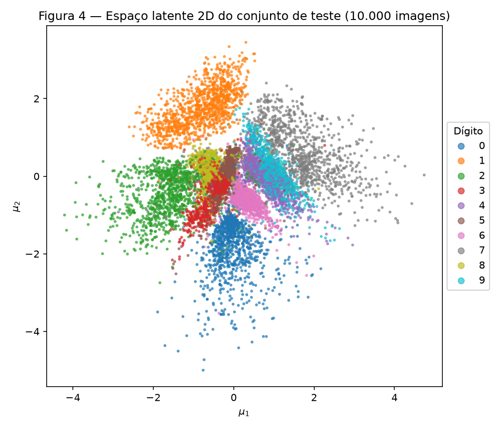
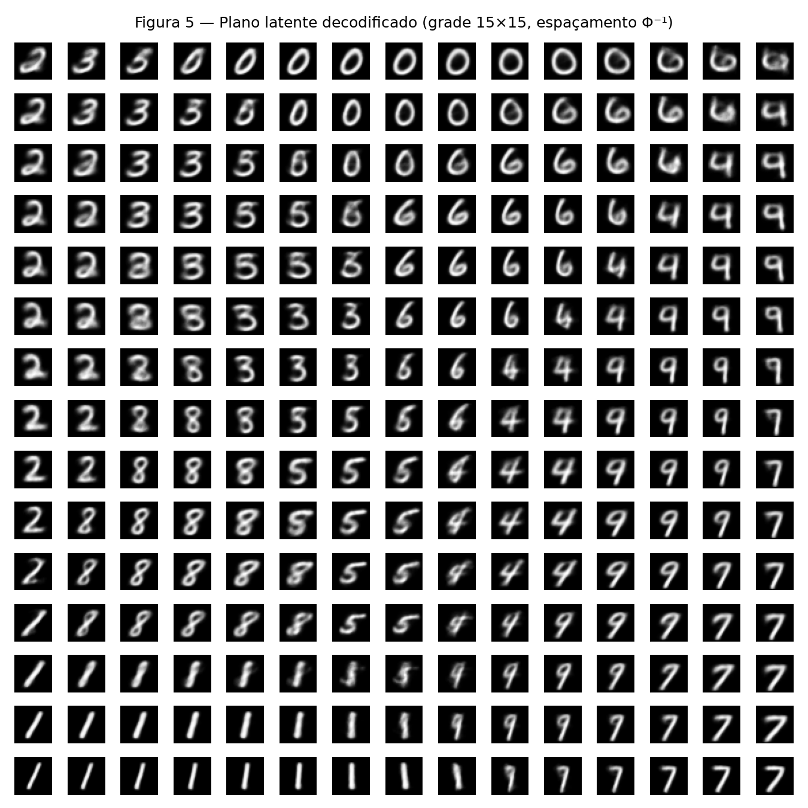
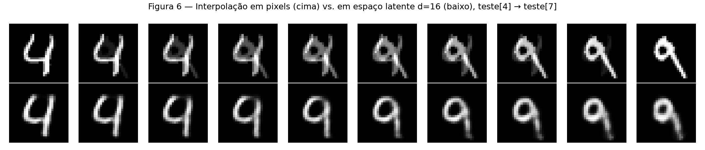

# 4. VAE

!!! abstract "Enunciado"

    [Exercises → VAE](https://insper.github.io/ann-dl/){:target='_blank'}

## Exercise 1

### Abordagem

Carreguei o MNIST via `torchvision` e dividi exatamente como especificado (50k treino / 10k
validação via `random_split` com semente 42 / 10k teste oficial). O VAE (`code/vae.py`) segue a
arquitetura dada — encoder `784→512→256` (ReLU), duas cabeças lineares `256→d` para `mu` e
`log sigma^2`, decoder `d→256→512→784` (ReLU nas ocultas, sigmoide na saída) — com
reparametrização, BCE de reconstrução e KL em forma fechada escritas à mão (nada de
`torch.distributions.kl_divergence` ou classe de VAE pronta). Treinei com Adam
(`lr=1e-3`, lotes de 128, 20 épocas), registrando reconstrução e KL **separadamente** no treino
e na validação a cada época; o teste só entra nos números finais.

### Código

O modelo vive em [`code/vae.py`](https://github.com/fernandoko3lle/Redes-Neurais_-_DeepLearnig/blob/main/docs/exercises/vae/code/vae.py)
e é reutilizado sem alterações no Exercise 2 (só muda o argumento `d`):

``` { .python .copy .select linenums='1' title="docs/exercises/vae/code/vae.py" }
--8<-- "docs/exercises/vae/code/vae.py"
```

Script deste exercício: [`code/exercise1_mnist.py`](https://github.com/fernandoko3lle/Redes-Neurais_-_DeepLearnig/blob/main/docs/exercises/vae/code/exercise1_mnist.py).

``` { .python .copy .select linenums='1' title="docs/exercises/vae/code/exercise1_mnist.py" }
--8<-- "docs/exercises/vae/code/exercise1_mnist.py"
```

### Figuras


/// caption
**Figura 1** — Termo de reconstrução e termo KL (nats/imagem), treino e validação, 20 épocas.
///


/// caption
**Figura 2** — Primeiro exemplo de teste de cada dígito (cima) e sua reconstrução decodificando
`mu` (baixo).
///


/// caption
**Figura 3** — 64 imagens decodificadas de `z ~ N(0, I)` (semente 0).
///

### Análise

**C — Treine**

Reconstrução no teste = **80,2365** nats, KL no teste = **20,5271** nats, ELBO negativo
(soma) = **100,7636** nats — perto da referência do enunciado (~81 de reconstrução, ~20 de
KL).

**E — Análise**

> Figura 1: a KL sobe nas primeiras épocas enquanto a perda total cai. Por que o otimizador
> escolheria pagar mais KL?

Porque o otimizador minimiza a **soma** dos dois termos, não cada um isoladamente. No início,
com os pesos quase aleatórios, o posterior `q(z|x)` carrega pouca informação sobre `x` (está
perto do prior, KL baixa) — e um código que não distingue bem as entradas produz reconstrução
ruim (177 nats na época 1). Conforme o treino avança, "afastar" `mu` de zero e encolher `sigma`
custa mais KL (sobe de 6,78 para 20,21 nats de treino — um aumento de ~13,4 nats), mas permite
que o código carregue informação suficiente para reconstruir bem, derrubando a reconstrução de
177,28 para 80,09 nats — uma queda de ~97 nats. Como 97 >> 13,4, vale a pena pagar mais KL: a
soma (o que de fato é minimizado) cai, mesmo que a KL isoladamente suba.

> A Figura 3 parece pior que a Figura 2 — dígitos mais borrados, alguns que não são dígito
> nenhum. Dê duas razões distintas.

**Onde as amostras do prior caem:** `N(0, I)` espalha massa de forma isotrópica por todo o
espaço latente de 16 dimensões, inclusive em regiões que o posterior aproximado dos dados reais
raramente visita (o agregado dos `q(z|x)` de todas as imagens de treino não cobre o prior
perfeitamente, sobretudo em 16 dimensões com treino limitado a 20 épocas) — uma amostra que cai
numa região "entre" ou "fora" dos agrupamentos que os dígitos reais ocupam não corresponde a
nenhum dígito bem definido.

**O que o decoder produz para um dado `z`:** o decoder só foi treinado em `z`'s vindos de
posteriors de imagens reais; para um `z` de uma região pouco (ou nunca) vista no treino, a saída
é extrapolação. Como a perda de reconstrução é uma verossimilhança de Bernoulli pixel a pixel
(não há nenhum termo que force nitidez), o decoder tende a produzir uma média borrada de
formas plausíveis em vez de comprometer-se com uma única forma nítida — o "borrão" característico
do VAE.

> Por que decodificar `mu` e não um `z` amostrado na Figura 2?

Porque a Figura 2 quer medir **a qualidade da representação aprendida** — o quanto o par
encoder/decoder preserva da entrada —, não a variância extra que a amostragem
`z = mu + sigma*eps` injetaria. `mu` é a estimativa pontual mais provável (a moda do
posterior aproximado, que é gaussiano); decodificá-la dá a reconstrução determinística e menos
ruidosa possível para aquela entrada. Usar um `z` amostrado misturaria "quão boa é a
representação" com "quanta sorte teve essa amostra específica de ruído", dificultando a leitura
da figura.

## Exercise 2

### Abordagem

Mesmo modelo e mesmo orçamento de treino do Exercise 1, só trocando `d=2`. Depois do treino,
codifiquei as 10 000 imagens de teste para visualizar o plano latente, decodifiquei uma grade
`15×15` espaçada pela inversa da CDF normal (`scipy.stats.norm.ppf`) para "ver" o plano inteiro,
e interpolei entre dois dígitos diferentes tanto no espaço de pixels quanto no espaço latente
do modelo `d=16` do Exercise 1 (carregado do checkpoint salvo).

### Código

Script: [`code/exercise2_latent2d.py`](https://github.com/fernandoko3lle/Redes-Neurais_-_DeepLearnig/blob/main/docs/exercises/vae/code/exercise2_latent2d.py).

``` { .python .copy .select linenums='1' title="docs/exercises/vae/code/exercise2_latent2d.py" }
--8<-- "docs/exercises/vae/code/exercise2_latent2d.py"
```

### Figuras


/// caption
**Figura 4** — `mu` das 10.000 imagens de teste, coloridas por dígito.
///


/// caption
**Figura 5** — Grade 15×15 de pontos latentes (espaçamento `Phi^-1`), decodificados.
///


/// caption
**Figura 6** — Interpolação entre `teste[4]` (dígito 4) e `teste[7]` (dígito 9): em pixels
(cima) vs. em espaço latente do modelo `d=16` (baixo).
///

### Análise

**A — Treine um VAE 2-D**

| | `d = 16` (Exercise 1) | `d = 2` (Exercise 2) |
|---|---|---|
| Reconstrução (teste, nats) | 80,2365 | 133,8001 |
| KL (teste, nats) | 20,5271 | 6,6787 |

Bate com a referência do enunciado (~135 de reconstrução, ~7 de KL para `d=2`).

**C — O plano decodificado**

> Diga em uma frase por que esse espaçamento dá a cada célula a mesma massa do prior.

`Phi^-1(q)` é a função quantil da normal padrão: por definição, intervalos igualmente espaçados
em `q` (probabilidade acumulada) correspondem a intervalos de `z` que contêm a mesma massa de
probabilidade sob `N(0,1)` — então espaçar `q` linearmente (em vez de `z`) faz cada célula da
grade representar uma fatia igualmente provável do prior, em vez de superamostrar o centro ou
desperdiçar células nas caudas raras.

**D — Interpolação**

Índices de teste interpolados: `idx_a = 4` (dígito **4**), `idx_b = 7` (dígito **9**).

**E — Análise**

> Quais dígitos se sobrepõem na Figura 4? Encontre a mesma transição na Figura 5 e descreva
> como são as imagens do meio do caminho.

Na Figura 4, os dígitos **0, 1, 2 e 7** formam agrupamentos bem isolados nas bordas do plano;
os dígitos **3, 4, 5, 6, 8 e 9** ficam todos amontoados numa região central comum, sem fronteiras
claras entre si. Essa mesma mistura aparece na Figura 5: seguindo a diagonal central da grade
(por volta das colunas 5-10), a imagem muda suavemente de um `2` para um `3`, depois `5`, `6`,
`4` e `9` — e nas células de transição (por exemplo entre as colunas que misturam `3`/`5`/`8`) a
imagem não é claramente nenhum dos dois: tem o laço de baixo de um `8` com o traço aberto de
cima de um `5`, ou a haste reta de um `4` já curvando no topo como um `9`.

> `d = 2` reconstrói claramente pior que `d = 16`. O que dois números por imagem obrigam o
> modelo a jogar fora? Use a Figura 5 como evidência.

Dois números só têm "espaço" para codificar os eixos de variação mais grosseiros — principalmente
*qual família de formato* o dígito tem (reto vs. com laço vs. arredondado, à julgar pela
disposição espacial das famílias na Figura 5: `0`/`6` arredondados de um lado, `1`/`7` retos do
outro). O que fica de fora é a identidade fina da classe e o estilo de traço: a Figura 5 mostra
`3`, `5`, `6`, `4`, `8` e `9` ocupando uma faixa contínua e embaralhada no meio da grade — o
modelo não tem dimensões sobrando para dar a cada um desses seis dígitos sua própria região
bem separada, então eles compartilham vizinhança e se confundem. Com `d = 16` (Figura 2) sobra
espaço para manter os 10 dígitos separados **e** preservar detalhes de traço.

> Compare as duas linhas da Figura 6. Qual delas passa por imagens que parecem dígitos e por
> que a outra não passa?

A linha de baixo (espaço latente, `d = 16`) passa por imagens que parecem dígitos o tempo todo —
o `4` vai se curvando gradualmente até virar um `9` plausível, porque o decoder só precisa
produzir saídas para pontos `(1-t)*mu_a + t*mu_b` que ficam relativamente perto da região do
espaço latente que ele já aprendeu a decodificar em dígitos reais (a "variedade" aprendida).
A linha de cima (pixels) produz, nos `t` intermediários, uma sobreposição fantasma dos dois
dígitos — um `4` e um `9` visualmente somados, sem parecer nenhum dígito real — porque a
média `(1-t)*x_a + t*x_b` é só uma mistura linear de intensidades de pixel, uma operação que
não "sabe" nada sobre a forma dos dígitos e não respeita a estrutura não linear do que faz uma
imagem parecer um traço contínuo e reconhecível.

## Resumo dos resultados

| # | Quantidade | Valor |
|---|---|---|
| 1 | Ex. 1 — reconstrução, KL e ELBO negativo no teste (`d = 16`) | 80,2365 / 20,5271 / 100,7636 nats |
| 2 | Ex. 1 — KL de validação na primeira e na última época | 13,2885 (época 1) / 20,4795 (época 20) |
| 3 | Ex. 2 — reconstrução e KL no teste (`d = 2`) | 133,8001 / 6,6787 nats |
| 4 | Ex. 2 — os dois índices de teste interpolados | `idx_a = 4` (dígito 4), `idx_b = 7` (dígito 9) |
