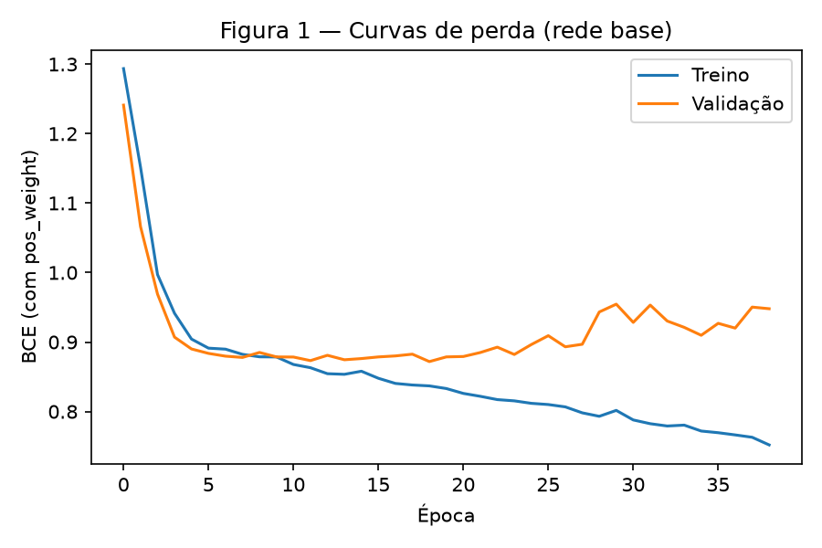
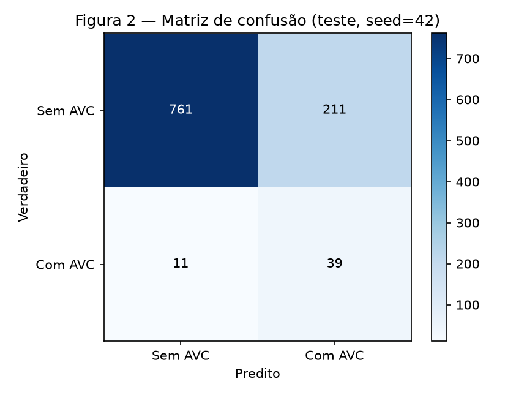
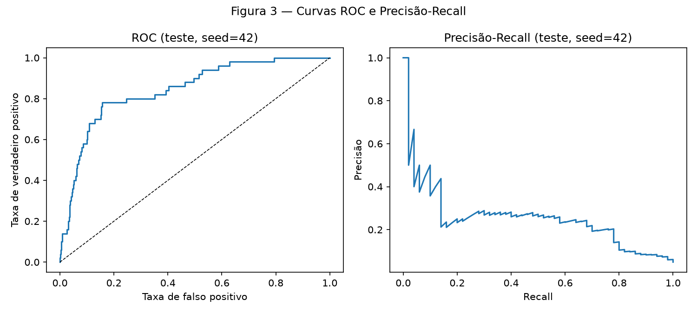
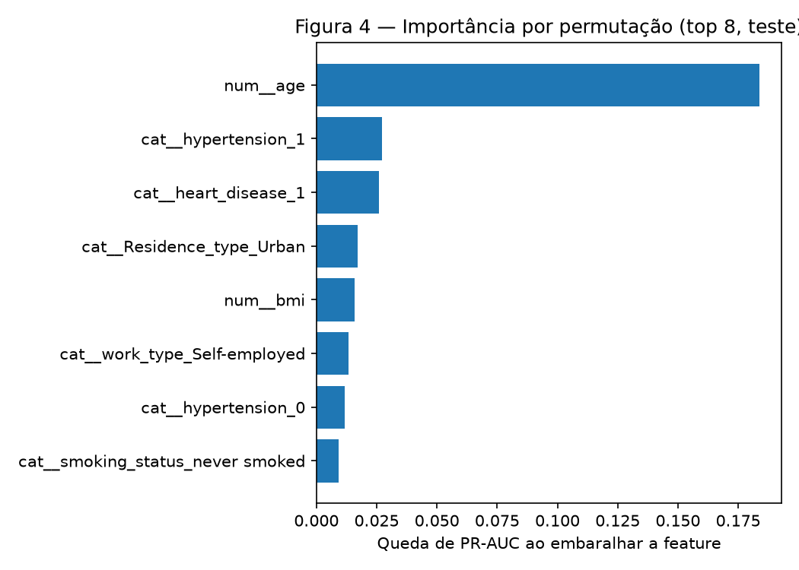

# 2. Classificação

!!! abstract "Entrega 2 de 3 do [Projeto](../index.md)"

    [Projects → Supervised](https://insper.github.io/ann-dl/){:target='_blank'}

!!! info "Equipe"

    | Nome completo | GitHub |
    |---------------|--------|
    | Fernando Ganzer Koelle | [@fernandoko3lle](https://github.com/fernandoko3lle) |

    Dataset, decisões e status: [página do projeto](../index.md).

Dataset, decisões e proposta aprovada estão na [página do projeto](../index.md) e no
[EDA](../eda/index.md) — não repetidos aqui. Resumo rápido: **Stroke Prediction Dataset**
(Kaggle), tarefa de **classificação binária** (alvo `stroke`), ~4,87% de casos positivos.

## 0. Ponto de partida

O pipeline é o [`pipeline.py`](https://github.com/fernandoko3lle/Redes-Neurais_-_DeepLearnig/blob/main/docs/projects/eda/code/pipeline.py)
do EDA, **importado** (não copiado) em [`code/data.py`](https://github.com/fernandoko3lle/Redes-Neurais_-_DeepLearnig/blob/main/docs/projects/classification/code/data.py),
junto com a correção de outliers (`cap_outliers`) apontada lá — ambos ajustados só no treino.
Mesmo split 80/20 estratificado do EDA (semente 42); a validação sai de um segundo split
80/20 estratificado **dentro** do treino, mesma semente: **3.270 treino / 818 validação /
1.022 teste**.

**Definidos antes de treinar qualquer rede:**

- **Métrica principal:** `PR-AUC` (average precision). Escolhida em vez de `ROC-AUC` porque,
  com só ~4,9% de positivos, a `ROC-AUC` fica otimista (o eixo de falsos positivos é dominado
  pela classe majoritária); `PR-AUC` é sensível à raridade da classe positiva.
- **Critério de sucesso:** `PR-AUC` da rede, no teste, **≥ 1,20× a `PR-AUC` do melhor baseline**
  (também no teste).

### Código

[`code/data.py`](https://github.com/fernandoko3lle/Redes-Neurais_-_DeepLearnig/blob/main/docs/projects/classification/code/data.py):

``` { .python .copy .select linenums='1' title="docs/projects/classification/code/data.py" }
--8<-- "docs/projects/classification/code/data.py"
```

## 1. Baselines

Avaliados na **validação**, no mesmo pipeline:

| Baseline | PR-AUC | ROC-AUC | F1-macro |
|---|---|---|---|
| Trivial (`DummyClassifier`, classe majoritária) | 0,0489 | 0,5000 | 0,4875 |
| Linear (`LogisticRegression`) | 0,1799 | 0,8463 | 0,4875 |

Melhor baseline (validação): **regressão logística**, `PR-AUC = 0,1799`.

## 2. A rede

MLP em PyTorch, 1 logit de saída (`BCEWithLogitsLoss` com `pos_weight = 19,566` — a razão
negativos/positivos do treino, já que o enunciado deste projeto pede tratar o desbalanceamento
na perda). Arquitetura de partida: `23 → 32 → 16 → 1` (ReLU nas ocultas) — **1.313 parâmetros**
contra **3.270 linhas de treino** (≈ 2,5 linhas por parâmetro): rede pequena de propósito,
dado o tamanho do treino e o risco de overfitting já visto no EDA (dataset de 5 mil linhas).

### Código

[`code/mlp.py`](https://github.com/fernandoko3lle/Redes-Neurais_-_DeepLearnig/blob/main/docs/projects/classification/code/mlp.py)
(reutilizado sem alterações nas Etapas 3-5):

``` { .python .copy .select linenums='1' title="docs/projects/classification/code/mlp.py" }
--8<-- "docs/projects/classification/code/mlp.py"
```

## 3. Treinamento

Adam, `lr = 1e-3`, lotes de 64, até 300 épocas, parada antecipada com paciência de 20 épocas
pela perda de validação, restaurando os melhores pesos (checkpoint) — exatamente o esqueleto do
enunciado. A rede base parou na **época 39** (perda de treino final `0,7519`, validação
`0,9480`).

### Figuras


/// caption
**Figura 1** — Perda de treino e validação por época (rede base, sem regularização).
///

A curva de treino continua caindo depois da época ~10, enquanto a de validação estabiliza e
começa a subir — o clássico sinal de **overfitting** a partir daí; a parada antecipada evita
continuar treinando sobre esse ponto.

## 4. Regularização e hiperparâmetros

**Comparação de regularização** (mesma arquitetura `[32, 16]`, validação):

| Variante | PR-AUC (val) | Época de parada |
|---|---|---|
| Sem regularização | 0,1744 | 27 |
| Weight decay (`wd = 1e-3`) | 0,1587 | 30 |
| Dropout (`p = 0,3`) | 0,1722 | 42 |

Nenhuma das duas técnicas melhorou a `PR-AUC` de validação em relação a treinar sem
regularização — plausível: a rede já é pequena (1.313 parâmetros) e a parada antecipada já
contém boa parte do overfitting sozinha, então regularização adicional só tira capacidade sem
reduzir mais variância.

**Busca de hiperparâmetros** (10 configurações, ordenadas por `PR-AUC` de validação):

| # | Camadas ocultas | `lr` | `wd` | Dropout | PR-AUC (val) | Época de parada |
|---|---|---|---|---|---|---|
| 1 | `[64, 32, 16]` | 0,001 | 0,0001 | 0,2 | **0,1971** | 28 |
| 2 | `[32]` | 0,001 | 0 | 0 | 0,1882 | 39 |
| 3 | `[16]` | 0,001 | 0 | 0 | 0,1868 | 47 |
| 4 | `[64, 32]` | 0,001 | 0,0001 | 0,2 | 0,1823 | 30 |
| 5 | `[32, 16]` | 0,001 | 0,0001 | 0,2 | 0,1810 | 32 |
| 6 | `[32, 16]` | 0,001 | 0 | 0 | 0,1744 | 27 |
| 7 | `[32, 16]` | 0,0003 | 0 | 0 | 0,1736 | 47 |
| 8 | `[32, 16]` | 0,001 | 0 | 0,3 | 0,1722 | 42 |
| 9 | `[32, 16]` | 0,01 | 0 | 0 | 0,1588 | 21 |
| 10 | `[32, 16]` | 0,001 | 0,001 | 0 | 0,1587 | 30 |

**Configuração escolhida:** `[64, 32, 16]`, `lr = 0,001`, `wd = 0,0001`, `dropout = 0,2`
(`PR-AUC` de validação `0,1971`) — a rede mais funda da busca, com uma dose leve de dropout e
weight decay, venceu as variantes mais rasas e as sem nenhuma regularização.

## 5. Avaliação no teste

A configuração escolhida foi retreinada do zero em **3 sementes** (42, 43, 44); o teste só foi
usado **uma vez por semente**, depois de toda decisão de hiperparâmetro já fechada pela
validação. O limiar de decisão foi escolhido por semente, maximizando o F1 da classe positiva
na validação — priorizando não deixar passar casos de AVC em vez de maximizar acurácia simples
(o custo de um falso negativo aqui é clinicamente maior que o de um falso positivo).

| Semente | Limiar | PR-AUC (teste) | ROC-AUC (teste) | F1-macro (teste) |
|---|---|---|---|---|
| 42 | 0,651 | 0,2612 | 0,8432 | 0,5664 |
| 43 | 0,704 | 0,2619 | 0,8398 | 0,6071 |
| 44 | 0,733 | 0,2580 | 0,8415 | 0,5972 |

**PR-AUC no teste (média ± desvio, 3 sementes): `0,2604 ± 0,0017`.**

| Modelo | PR-AUC (teste) |
|---|---|
| Dummy (trivial) | 0,0489 |
| Logística (linear) | **0,2756** |
| MLP (média de 3 sementes) | 0,2604 ± 0,0017 |

**Critério de sucesso (Etapa 0) atingido? Não.** `0,2604 < 1,20 × 0,2756 = 0,3308` — a MLP nem
sequer superou a regressão logística nesta tarefa (0,2604 contra 0,2756), quanto mais bater
20% acima dela. A diferença entre os dois (0,0152) é quase 9× maior que o desvio entre sementes
(0,0017), e a direção é consistente nas 3 sementes: a logística ganha da MLP em todas.


/// caption
**Figura 2** — Matriz de confusão no teste (seed 42, limiar 0,651): 761 verdadeiro-negativos,
211 falso-positivos, 11 falso-negativos, 39 verdadeiro-positivos.
///


/// caption
**Figura 3** — ROC (esquerda) e Precisão-Recall (direita) no teste (seed 42).
///

Com esse limiar, a rede detecta 39 dos 50 casos reais de AVC no teste (recall de 78% na
classe positiva), ao custo de 211 falsos alarmes — uma troca deliberada: o limiar foi escolhido
para não perder casos positivos, não para acertar tudo.

## 6. Análise de erros

**Taxa de erro por subgrupo** (teste, seed 42):

| Subgrupo | Taxa de erro | n |
|---|---|---|
| `hypertension = 0` | 17,16% | 921 |
| `hypertension = 1` | **63,37%** | 101 |
| `heart_disease = 0` | 20,06% | 967 |
| `heart_disease = 1` | **50,91%** | 55 |

O erro é muito maior exatamente nos subgrupos de maior risco (`hypertension = 1`,
`heart_disease = 1`) — mas não porque o modelo erra o AVC *neles*; é o oposto: como a matriz de
confusão é dominada por falsos positivos (211 contra só 11 falsos negativos), a maior parte do
"erro" nesses subgrupos é a rede marcar como risco de AVC pacientes hipertensos/cardiopatas que,
neste teste específico, não tiveram o evento — o modelo aprendeu corretamente que esses fatores
elevam o risco (consistente com a Figura 5 do EDA) e por isso fica mais "nervoso" com esses
pacientes, errando para o lado conservador.

**5 piores exemplos** (maior `|probabilidade − rótulo|`):

| idx | `y` | `prob` | `age` | `hypertension` | `heart_disease` |
|---|---|---|---|---|---|
| 553 | 1 | 0,0124 | 14 | 0 | 0 |
| 165 | 1 | 0,0654 | 45 | 0 | 0 |
| 686 | 1 | 0,0863 | 42 | 0 | 0 |
| 436 | 0 | 0,8756 | 81 | 1 | 1 |
| 240 | 1 | 0,1254 | 32 | 0 | 0 |

Quatro dos cinco piores erros são **falsos negativos em pacientes jovens sem hipertensão nem
doença cardíaca** (14, 45, 42 e 32 anos) — casos de AVC que a rede não tinha nenhum sinal de
risco "clássico" para prever, já que idade é o fator dominante (ver importância por permutação
abaixo) e esses pacientes são justamente os que a rede, corretamente segundo os dados, julgaria
de baixo risco. O quinto (idx 436) é o oposto: 81 anos, hipertenso e cardiopata — um paciente
que "deveria" ter tido o evento segundo o perfil de risco, mas não teve.


/// caption
**Figura 4** — Queda de PR-AUC no teste ao embaralhar cada feature (top 8).
///

`age` domina isoladamente (queda de PR-AUC de **0,1839**, mais de 6× a segunda colocada) —
bate exatamente com o EDA, onde `age` já era a numérica mais correlacionada com o alvo (Spearman
0,25) e a mais separada no boxplot por classe (Figura 6 do EDA). Em seguida vêm
`hypertension`/`heart_disease` (quedas de ~0,027/0,026), também consistentes com a Figura 5 do
EDA (maior taxa de AVC nesses grupos). A rede não "descobriu" nenhum fator de risco que o EDA
não tivesse apontado — ela aprendeu, com outra ferramenta, os mesmos sinais que a análise
exploratória já tinha revelado.

## 7. Conclusão

**A rede valeu a pena?** Não, pelo critério definido na Etapa 0 — e esse é o resultado honesto
a reportar, não um erro de implementação: a regressão logística (um baseline linear) teve
`PR-AUC` de teste igual ou melhor que a MLP nas 3 sementes. Com só 3.270 linhas de treino, 23
features (a maioria binárias de one-hot) e um sinal dominado por uma única feature contínua
(`age`) de relação aproximadamente monotônica com o alvo, o problema tem pouca estrutura não
linear para uma rede explorar — exatamente o tipo de cenário em que um modelo linear simples
compete de igual para igual com uma MLP.

**Limitações:** o dataset é pequeno para o padrão de redes neurais e extremamente desbalanceado
(50 casos positivos no teste inteiro) — qualquer métrica no teste tem alta variância amostral
(um único caso a mais ou a menos muda a `PR-AUC` de forma visível). **Quem seria afetado por um
erro:** um falso negativo aqui é um paciente de risco real de AVC classificado como baixo risco
— o custo mais grave dos dois tipos de erro, e a escolha de limiar da Etapa 5 já reflete isso
(prioriza recall). **Com mais tempo:** valeria tentar reamostragem (SMOTE) em vez de só
`pos_weight`, e um modelo de árvores (random forest/boosting) como segundo baseline — o
enunciado já avisa que eles costumam empatar com a rede em dados tabulares, e aqui a suspeita é
que também empatariam ou ganhariam.

**Bônus de competição:** não se aplica — o Stroke Prediction Dataset é uma página de dataset do
Kaggle, não uma competição aberta com submissão e *leaderboard* (ao contrário de, por exemplo,
Titanic/Spaceship Titanic), então não há como gerar a submissão que o bônus pede.

## Resumo dos resultados

| # | Resumo | Valor |
|---|---|---|
| 1 | Dataset, tarefa, alvo e métrica principal | Stroke Prediction Dataset, classificação binária, alvo `stroke`, métrica principal PR-AUC |
| 2 | Treino · validação · teste (linhas) | 3.270 · 818 · 1.022 |
| 3 | Melhor baseline e sua métrica no teste | Regressão logística, PR-AUC = 0,2756 |
| 4 | Rede escolhida: camadas × unidades, nº de parâmetros, regularização | `23→64→32→16→1`, weight decay 1e-4 + dropout 0,2 |
| 5 | Otimizador, taxa, batch e época em que parou | Adam, lr=0,001, batch=64, parada ~época 28 (varia por semente) |
| 6 | Métrica principal da rede no teste (média ± desvio, 3 sementes) | PR-AUC = 0,2604 ± 0,0017 |
| 7 | Critério de sucesso atingido? | Não (0,2604 < 1,20 × 0,2756 = 0,3308) |
| 8 | Subgrupo com o maior erro e o valor | `hypertension = 1`, taxa de erro 63,37% |
