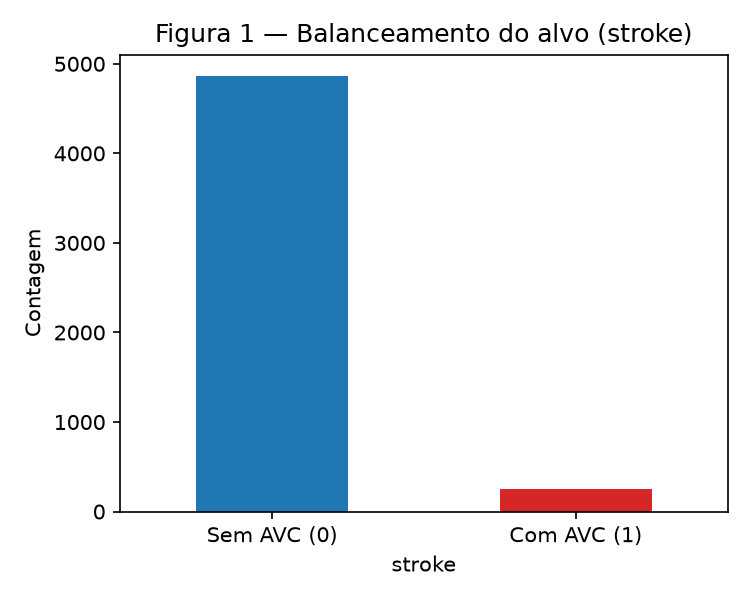
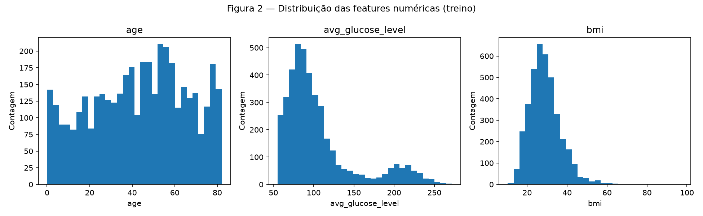
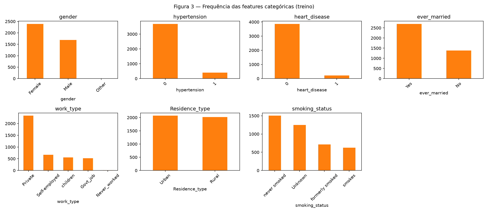
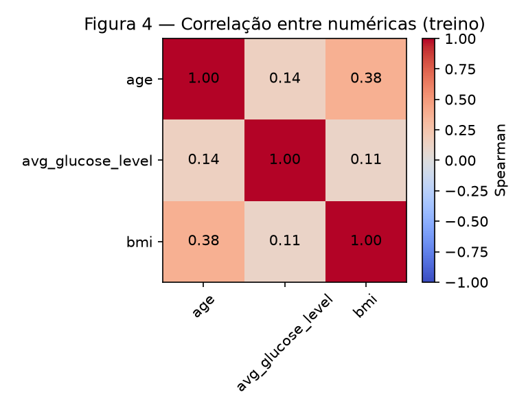
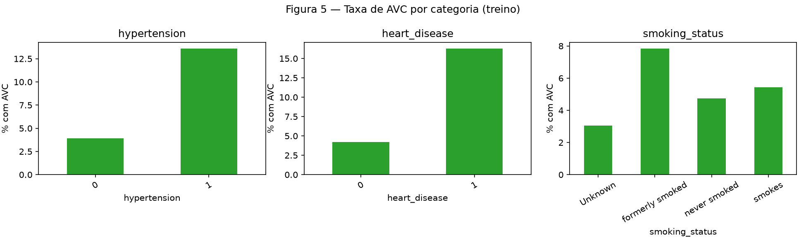
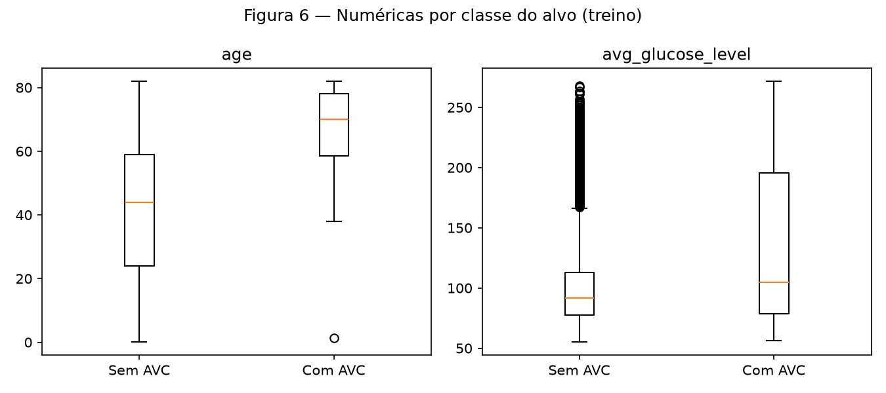
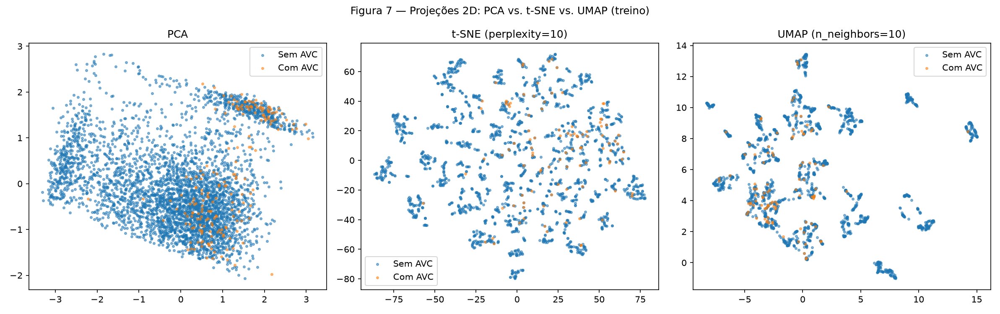
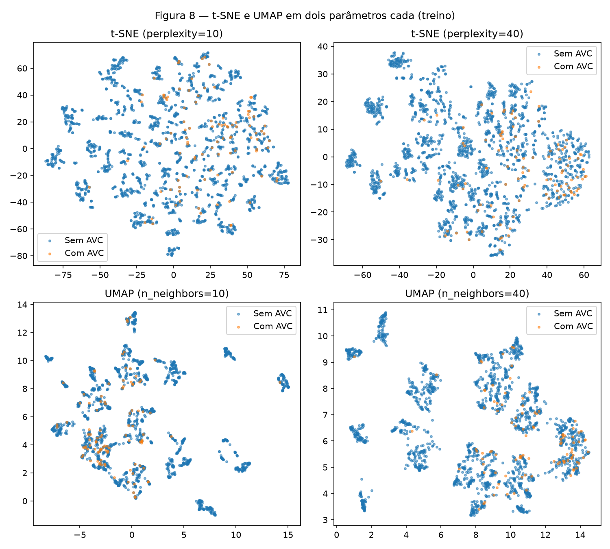

# 1. EDA — Análise Exploratória

!!! abstract "Entrega 1 de 3 do [Projeto](../index.md)"

    [Projects](https://insper.github.io/ann-dl/){:target='_blank'}

!!! success "Dataset aprovado"

    O **Stroke Prediction Dataset** foi validado pelo professor a partir da proposta enviada
    pelo [formulário da disciplina](https://forms.gle/zREqauuojy8Phvbb7){:target='_blank'}.

!!! info "Equipe"

    | Nome completo | GitHub |
    |---------------|--------|
    | Fernando Ganzer Koelle | [@fernandoko3lle](https://github.com/fernandoko3lle) |

    Dataset, decisões e status: [página do projeto](../index.md).

## 0. Proposta

**Dataset:** [Stroke Prediction Dataset](https://www.kaggle.com/datasets/fedesoriano/stroke-prediction-dataset)
(Kaggle, autor fedesoriano) — 5.110 linhas × 12 colunas, alvo `stroke` já presente no arquivo.

**Motivação:** mistura genuína de features numéricas (`age`, `avg_glucose_level`, `bmi`) e
categóricas (histórico de hipertensão, doença cardíaca, tabagismo, tipo de trabalho etc.), com
alvo fortemente desbalanceado (~5% positivo) — a tarefa deixa de ser trivial porque um
classificador "sempre não" já acerta ~95%, então o projeto precisa lidar com desbalanceamento
de verdade, não só treinar um modelo qualquer.

**Primeiro risco identificado:** desbalanceamento severo da classe positiva; a feature `bmi`
tem ~4% de valores faltantes.

## 1. Inspeção inicial

### A — Dicionário de dados

Cada linha é um paciente de uma base de registros de saúde publicada no Kaggle, usada para
avaliação de risco de AVC (*stroke*).

| Feature | Tipo | Unidade / categorias | Significado |
|---|---|---|---|
| `id` | identificador | — | Chave única do paciente (descartada, sem valor preditivo) |
| `gender` | categórica nominal | Male / Female / Other | Sexo do paciente |
| `age` | numérica contínua | anos | Idade |
| `hypertension` | categórica binária | 0 / 1 | Diagnóstico de hipertensão |
| `heart_disease` | categórica binária | 0 / 1 | Diagnóstico de doença cardíaca |
| `ever_married` | categórica nominal | Yes / No | Já foi casado(a) |
| `work_type` | categórica nominal | Private / Self-employed / Govt_job / children / Never_worked | Tipo de ocupação |
| `Residence_type` | categórica nominal | Urban / Rural | Tipo de residência |
| `avg_glucose_level` | numérica contínua | mg/dL | Nível médio de glicose no sangue |
| `bmi` | numérica contínua | kg/m² | Índice de massa corporal |
| `smoking_status` | categórica nominal | never smoked / formerly smoked / smokes / Unknown | Hábito de fumar |
| `stroke` | **alvo**, binária | 0 / 1 | Teve AVC |

### B — Qualidade

| Coluna | Faltantes | % |
|---|---|---|
| `bmi` | 201 | 3,93% |

Nenhuma outra coluna tem valor faltante. Não há linhas duplicadas (nem por todas as colunas,
nem por `id`). `gender` tem uma categoria rara (`Other`, 1 ocorrência) que não é inconsistência
— é um valor legítimo e raro. Coluna descartada: `id` (identificador puro, não carrega
informação preditiva e não vaza o alvo, só não serve pra nada).

### C — Alvo

`stroke`: **4,87%** positivo (249 de 5.110), **95,13%** negativo — desbalanceamento forte
(~19,5 casos negativos para cada positivo). Um classificador trivial que sempre prevê "sem
AVC" já acerta 95,13% — esse é o baseline que qualquer modelo real precisa superar, e a métrica
de acurácia sozinha não vai servir para avaliar a entrega de Classificação.


/// caption
**Figura 1** — Contagem de pacientes com e sem AVC.
///

### D — Treino e teste

Split 80/20 estratificado pelo alvo, semente fixa (`random_state=42`): **4.088** amostras de
treino, **1.022** de teste. A partir daqui, toda estatística de pré-processamento é calculada
só no treino.

## 2. Análise univariada

### A — Numéricas

| Feature | Média | Mediana | Desvio | Q1 | Q3 | Mín | Máx |
|---|---|---|---|---|---|---|---|
| `age` | 43,35 | 45,00 | 22,60 | 26,00 | 61,00 | 0,08 | 82,00 |
| `avg_glucose_level` | 106,32 | 91,95 | 45,26 | 77,31 | 114,20 | 55,12 | 271,74 |
| `bmi` | 28,92 | 28,00 | 7,93 | 23,60 | 33,10 | 10,30 | 97,60 |


/// caption
**Figura 2** — Histogramas de `age`, `avg_glucose_level` e `bmi` (treino).
///

`age` tem distribuição razoavelmente uniforme ao longo da vida adulta, sem assimetria forte.
`avg_glucose_level` e `bmi` são as duas com cauda longa à direita (média bem acima da mediana
em ambas) — alguns pacientes com glicose/IMC muito altos puxam a cauda, o que já antecipa a
necessidade de tratar outliers no item 4A.

### B — Categóricas

| Feature | Cardinalidade | Categoria mais frequente | Categoria(s) rara(s) |
|---|---|---|---|
| `gender` | 3 | Female (58,6%) | `Other` (1 caso) |
| `hypertension` | 2 | 0 (90,3%) | — |
| `heart_disease` | 2 | 0 (94,6%) | — |
| `ever_married` | 2 | Yes (66,0%) | — |
| `work_type` | 5 | Private (57,0%) | `Never_worked` (13 casos, 0,3%) |
| `Residence_type` | 2 | Urban (50,6%) | — |
| `smoking_status` | 4 | never smoked (36,7%) | — |


/// caption
**Figura 3** — Contagem por categoria de cada feature categórica (treino).
///

A categoria de alta cardinalidade relativa é `work_type` (5 níveis), com `Never_worked`
praticamente residual (13 em 4.088) — candidata a ficar com pouquíssimas amostras em algum
fold de validação futuro. `gender = Other` tem 1 única ocorrência: o one-hot ainda cria a
coluna, mas ela quase não carrega sinal estatístico.

## 3. Análise bivariada e multivariada

### A — Numérica × numérica

Usei correlação de **Spearman** (não Pearson) porque `avg_glucose_level` e `bmi` são
assimétricas (item 2A) — Spearman mede relação monotônica sem assumir forma linear nem
sensibilidade a outliers.


/// caption
**Figura 4** — Matriz de correlação de Spearman (treino).
///

O par mais correlacionado é `age` × `bmi` (0,38) — correlação moderada, esperada (IMC tende a
subir com a idade até certo ponto), mas longe de redundância: nenhum par passa de 0,4, então
não há necessidade de descartar nenhuma das três por colinearidade.

### B — Categórica × alvo


/// caption
**Figura 5** — Proporção de pacientes com AVC dentro de cada categoria (treino).
///

`heart_disease = 1` e `hypertension = 1` têm taxa de AVC visivelmente mais alta que suas
contrapartes em 0 — consistente com o que se espera clinicamente, o que é um bom sinal de que
o dataset não tem uma relação absurda com o alvo (não é vazamento, é fator de risco real).
`smoking_status` mostra `formerly smoked` com a taxa mais alta — plausível, já que esse grupo
tende a ser mais velho.

### C — Numérica × categórica


/// caption
**Figura 6** — `age` e `avg_glucose_level` por classe do alvo (treino).
///

A diferença mais clara é em `age`: pacientes com AVC são visivelmente mais velhos (mediana bem
mais alta e caixa deslocada para cima), tanto em posição quanto com menos espalhamento para
baixo. `avg_glucose_level` também desloca para cima no grupo com AVC, mas com mais sobreposição
entre os dois grupos — é um sinal mais fraco que `age` isoladamente.

## 4. Pré-processamento

### A — Estratégias

Cada escolha aponta para um achado das etapas anteriores:

- **Faltantes:** só `bmi` tem faltantes (3,93%, item 1B) — imputação pela **mediana**, ajustada
  só no treino, porque a mediana é robusta à cauda longa de `bmi` (item 2A) e a taxa de
  faltantes é baixa o bastante para não exigir uma estratégia mais sofisticada.
- **Outliers:** `avg_glucose_level` e `bmi` têm cauda longa (item 2A) — apliquei
  *winsorização* (cap pelos limites de `IQR × 1,5`, calculados só no treino) nessas duas
  colunas. Isso afetou **593** linhas do treino (14,5%). Escolhi capar em vez de remover
  porque glicose e IMC altos são clinicamente plausíveis (não são erro de digitação) e, em um
  dataset já desbalanceado, descartar linhas reduziria ainda mais a classe minoritária.
- **Encoding:** `OneHotEncoder(handle_unknown="ignore")` nas 7 categóricas — trata qualquer
  categoria que apareça no teste e não no treino atribuindo zero a todas as colunas daquela
  feature, em vez de quebrar o pipeline.
- **Escalonamento:** `StandardScaler` (média 0, desvio 1) nas 3 numéricas — destino é uma rede
  neural, e padronização evita que `avg_glucose_level` (escala de dezenas a centenas) domine
  `age`/`bmi` no cálculo de distâncias/gradientes.

### B — Redução de dimensionalidade


/// caption
**Figura 7** — Projeções 2D do treino: PCA, t-SNE (`perplexity=10`) e UMAP (`n_neighbors=10`).
///


/// caption
**Figura 8** — t-SNE com `perplexity` 10 e 40; UMAP com `n_neighbors` 10 e 40.
///

**PCA:** PC1 explica 30,19% da variância, PC2 mais 15,29% — **45,47%** juntos. Pelos
*loadings*, PC1 é dominado por `age` (0,63) e `bmi` (0,53) — um eixo de "idade/IMC avançando
juntos" —, enquanto PC2 é dominado quase sozinho por `avg_glucose_level` (0,94) — um eixo
praticamente só de glicose. Com menos da metade da variância nos 2 primeiros componentes, a
PCA por si só perde bastante estrutura do dataset original (23 colunas após o encoding).

**t-SNE:** com `perplexity=10` os agrupamentos ficam mais numerosos e compactos; com
`perplexity=40`, mais larga e contínua — comportamento esperado (perplexidade baixa prioriza
vizinhança local, alta suaviza para estrutura mais global). Em nenhum dos dois parâmetros as
duas classes formam regiões separadas — o que é coerente com o desbalanceamento (os poucos
casos positivos aparecem espalhados entre os negativos, não como seu próprio cluster).

**UMAP:** com `n_neighbors=10` aparecem bem mais ilhas pequenas e desconectadas que no t-SNE
equivalente; com `n_neighbors=40` essas ilhas se fundem em grupos maiores — mesma lógica do
t-SNE (vizinhança menor = estrutura mais local e fragmentada), só que o UMAP preserva mais
separação entre os clusters no espaço de saída. Como no t-SNE, os casos de AVC (laranja) não
formam uma região própria em nenhum dos dois parâmetros — aparecem espalhados dentro dos
clusters dominados pela classe negativa.

**Comparação:** as duas projeções não lineares (t-SNE, UMAP) revelam uma estrutura de
**múltiplos agrupamentos** nos pacientes — famílias de perfis parecidos — que a PCA simplesmente
não mostra: a Figura 7 (painel PCA) é uma nuvem praticamente contínua, sem separação visível em
grupos. Isso é esperado, já que a PCA só captura as direções lineares de maior variância,
enquanto t-SNE/UMAP preservam vizinhança local de forma não linear. Nenhuma das três, porém,
separa visualmente as duas classes do alvo — reforça o achado da Síntese de que o sinal
preditivo de `stroke` está distribuído de forma sutil entre várias features, não concentrado em
uma estrutura de cluster óbvia.

### C — Pipeline

O pipeline (`code/pipeline.py`, importável) usa `ColumnTransformer` com um ramo numérico
(mediana + `StandardScaler`) e um categórico (moda + `OneHotEncoder`), ajustado só no treino:

``` { .python .copy .select linenums='1' title="docs/projects/eda/code/pipeline.py" }
--8<-- "docs/projects/eda/code/pipeline.py"
```

Script que roda as 4 etapas e gera todas as figuras desta página:

``` { .python .copy .select linenums='1' title="docs/projects/eda/code/eda.py" }
--8<-- "docs/projects/eda/code/eda.py"
```

Depois do pipeline (incluindo o cap de outliers do item 4A): shape do treino **(4088, 23)**,
shape do teste **(1022, 23)**, **0** valores `NaN` em ambos. As 23 colunas finais são as 3
numéricas escalonadas mais 20 colunas one-hot (3 `gender` + 2 `hypertension` + 2
`heart_disease` + 2 `ever_married` + 5 `work_type` + 2 `Residence_type` + 4 `smoking_status`).

## 5. Síntese

**Principais achados:**

- O alvo é fortemente desbalanceado (4,87% positivo, item 1C/Figura 1) — a entrega de
  Classificação vai precisar de uma estratégia específica para isso (peso de classe,
  reamostragem, ou métrica que não seja só acurácia), não só treinar um modelo qualquer.
- `age` é o sinal mais claro associado ao AVC, tanto na correlação numérica quanto no boxplot
  por classe (itens 3A/3C, Figura 6); `hypertension` e `heart_disease` também mostram taxas de
  AVC visivelmente mais altas (item 3B, Figura 5) — clinicamente plausível, não parece
  vazamento.
- `avg_glucose_level` e `bmi` têm cauda longa (item 2A) que exigiu capar outliers antes do
  escalonamento (item 4A) — sem isso, poucos pacientes com valores extremos dominariam a
  escala da feature.
- A PCA sozinha preserva menos da metade da variância (45,47%) — a entrega de Classificação não
  deveria depender só de componentes principais como redução de dimensionalidade se precisar
  de uma versão compacta dos dados.

**Riscos para a modelagem e plano:**

- **Desbalanceamento severo** — mitigar com `class_weight`, re-amostragem (ex. SMOTE) ou
  limiar de decisão ajustado; avaliar com métricas sensíveis à classe minoritária (recall,
  F1, AUC), não acurácia.
- **`bmi` com faltantes e outliers** — já endereçado no pipeline (mediana + cap de IQR), mas
  revisar se a estratégia continua adequada quando o conjunto de treino mudar (nova
  amostragem, validação cruzada).
- **Categorias raras** (`gender = Other`, `work_type = Never_worked`) — podem não aparecer em
  todo fold de validação; o `handle_unknown="ignore"` do encoder evita que isso quebre o
  código, mas o modelo não vai ter sinal nenhum para essas categorias.

## Resumo dos resultados

| # | Valor |
|---|-------|
| 1. Dataset, tarefa e alvo | Stroke Prediction Dataset (Kaggle) — classificação binária, alvo `stroke` |
| 2. Instâncias × features (numéricas / categóricas) | 5.110 × 10 (3 numéricas / 7 categóricas) |
| 3. Coluna com mais faltantes e seu percentual | `bmi` — 3,93% (201/5.110) |
| 4. Colunas descartadas e o motivo | `id` — identificador, sem valor preditivo |
| 5. Classe minoritária (%) | `stroke = 1` — 4,87% (249/5.110) |
| 6. Tamanho do treino e do teste | 4.088 treino / 1.022 teste |
| 7. Par de numéricas mais correlacionado e o valor | `age` × `bmi`, Spearman = 0,381 |
| 8. Linhas afetadas pela estratégia de outliers | 593 (cap IQR×1,5 em `avg_glucose_level` e `bmi`, treino) |
| 9. Variância explicada por PC1 + PC2 | 45,47% (PC1 = 30,19%, PC2 = 15,29%) |
| 10. `shape` do treino e do teste após o pipeline | (4088, 23) / (1022, 23) |
